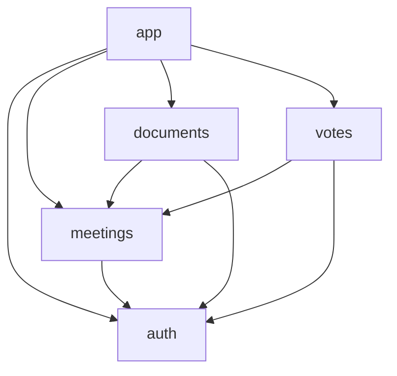

[](https://github.com/Rileyjrjohns/boardroom-flutter/actions/workflows/ci.yml)
[](https://github.com/Rileyjrjohns/boardroom-flutter/actions/workflows/e2e.yml)
[](https://github.com/Rileyjrjohns/boardroom-flutter/actions/workflows/release.yml)

# Boardroom (Flutter)

Board meetings, documents and votes: the Flutter port of Boardroom, built to show that a well-made hexagonal architecture lets the domain move from one framework to another.

Port of [Boardroom (React Native)](https://github.com/Rileyjrjohns/boardroom) with the same domain. Both apps follow the same specification, kept in [`docs/spec`](docs/spec).

Status: step 5 of 8, the presentation, done. The app has all its screens (see [Screens](#screens)); the domain and the application are translated, the adapters are written and tested (dio against the fixtures, the encrypted drift database, secure storage, biometrics, connectivity, monitoring), and the local plugin `packages/screen_protection` (Pigeon, Kotlin, Swift: [`docs/native-module.md`](docs/native-module.md)) is the native half of the `ScreenProtection` port. How the code is translated, file by file and test by test, is written in [`docs/porting.md`](docs/porting.md); the infrastructure and the plugin are mapped in [`docs/parity/infrastructure.md`](docs/parity/infrastructure.md), the presentation in [`docs/parity/presentation.md`](docs/parity/presentation.md), and the pattern of the screens is in [`docs/presentation.md`](docs/presentation.md). The code is organised by feature, then by layer: see [Features and layers](#features-and-layers) and [`docs/architecture.md`](docs/architecture.md).

## Requirements

- Flutter 3.47.4 (stable), which ships Dart 3.13.3. The version is pinned in `pubspec.yaml` (`environment.flutter`).
- Xcode for iOS, Android Studio (or the Android SDK) for Android.

## Getting started

```sh
flutter pub get      # installs the dependencies and generates the localization classes
dart run build_runner build   # generates the freezed classes and the JSON code of the DTOs
flutter gen-l10n     # regenerates the localization classes by hand (after editing an ARB file)
flutter run          # runs the app (the dev configuration: the fixtures behind the simulated server)
flutter run --dart-define=BOARDROOM_ADAPTERS=dev    # the same, named: the simulated server, with the demo accounts and the offline switch
flutter run --dart-define=BOARDROOM_ADAPTERS=http --dart-define=BOARDROOM_API_BASE_URL=https://api.example.com   # against a real API
flutter test         # runs all the tests
dart test test/core/domain test/core/application test/features/*/domain test/features/*/application test/app/composition test/support/fakes test/tool   # runs the pure Dart tests, without Flutter
```

## Generated code

Generated files are never committed. They are rebuilt with:

| What                                   | Command                                                    | Output                          |
| -------------------------------------- | ---------------------------------------------------------- | ------------------------------- |
| Localization classes (`AppLocalizations`) | `flutter gen-l10n` (also run by `flutter pub get`)       | `lib/l10n/app_localizations*.dart` |
| Freezed, JSON and drift code           | `dart run build_runner build` | `*.freezed.dart`, `*.g.dart`, `*.drift.dart` |

`flutter test` and `flutter analyze` do not regenerate the localization classes on their own: after a fresh clone, run `flutter pub get` first. The same goes for the freezed classes (the entities and value data of the `domain` folders of `lib/core` and `lib/features`): after a fresh clone, and after any change to a class annotated with `@freezed`, run `dart run build_runner build`, or `dart test` and `flutter analyze` fail on the missing `*.freezed.dart`. CI runs it before the analysis and the tests.
The drift code is generated in its modular form (`build.yaml`): each feature declares its tables, and the generator writes one `tables.drift.dart` beside each `tables.dart`, which the adapter of the feature and the database of `lib/app/persistence` import.
The texts live in `lib/l10n/app_en.arb` (English, the template and the fallback) and `lib/l10n/app_fr.arb` (French).

## Checks

[CI](.github/workflows/ci.yml) runs four jobs on every pull request and on every push to `main`. Run the same commands locally, from the root of the repository, after `flutter pub get` (and, for the last two jobs, `dart run build_runner build`). The infrastructure tests (`test/core/infrastructure`, `test/features/*/infrastructure`, `test/app` and `test/support/infrastructure`) run in their own step (`flutter test test/core/infrastructure test/features/*/infrastructure test/app test/support/infrastructure`) and again in the step `flutter test --coverage`: those that import Flutter or a plugin cannot run under `dart test`, so only the `domain` and `application` folders of `test/core` and `test/features/*`, the glue of `test/app/composition`, the fakes and the tooling run there.

**Import rules** (job `Import rules`): a file may only import what its layer allows, and a feature only the features that the graph names for it (see [Features and layers](#features-and-layers)).

```sh
dart run tool/check_imports.dart
```

**Analyze, format, tests, coverage** (job `Analyze, format, tests, coverage`):

```sh
dart run build_runner build   # the freezed classes, needed by the analysis and the tests
dart format --output=none --set-exit-if-changed .
flutter analyze --fatal-infos --fatal-warnings
dart test test/core/domain test/core/application test/features/*/domain test/features/*/application test/app/composition test/support/fakes test/tool   # pure Dart tests, no Flutter
flutter test test/core/infrastructure test/features/*/infrastructure test/app test/support/infrastructure   # the adapters: dio on the fixtures, drift, encrypted SQLite
flutter test test/core/presentation test/features/*/presentation   # the shared components, the query layer and the screens of every feature (the shell, the router and the header actions are in test/app, run by the step above)
flutter test --tags golden test/golden   # the golden images of the three key screens (see "Golden tests" below)
(cd packages/screen_protection && flutter test)   # the Dart side of the screen protection plugin
(cd android && ./gradlew :screen_protection:testDebugUnitTest)   # its Kotlin logic, on the JVM
(cd packages/screen_protection && dart run pigeon --input pigeons/screen_protection_api.dart && dart format lib && git diff --exit-code .)   # the generated channel is up to date
dart run tool/coverage_helper.dart       # writes test/coverage_helper_test.dart (ignored by Git)
flutter test --coverage                  # all the tests, writes coverage/lcov.info
dart run tool/coverage_gate.dart         # prints the coverage table, fails under a threshold
```

The coverage gate is on lines, the only figure that `flutter test --coverage` reports (the plugin is measured by its own tests, not by this gate). Generated files (`*.g.dart`, `*.freezed.dart`, `*.drift.dart` and the localization classes) are left out. The thresholds are the ones of the React Native repository:

| Scope                                                                      | Threshold |
| -------------------------------------------------------------------------- | --------- |
| domain: `lib/core/domain` and `lib/features/*/domain`                      | 90 %      |
| application: `lib/core/application` and `lib/features/*/application`      | 90 %      |
| everything else together (infrastructure, presentation, `lib/app`)         | 70 %      |

A layer with no code yet is not checked. `tool/coverage_helper.dart` imports every library of `lib/` in a generated test, so a file that no test loads counts as 0 % instead of being missing from the report. In CI the table is added to the summary of the run and `coverage/lcov.info` is uploaded as an artifact.

**Golden tests** (step `Golden tests` of the same job): the meetings list, the meeting detail (with the vote block under each resolution) and the document screen (the PDF view stood in for by a drawn page, with the watermark and the protected badge) are compared with images, in English and in French, at the width of a phone (390 logical pixels), with the light theme. Each image shows the states side by side. The package [alchemist](https://pub.dev/packages/alchemist) draws them.

| Image (`test/golden/goldens/ci/`)                | States, left to right                                  |
| ------------------------------------------------ | ------------------------------------------------------ |
| `meetings_list_en.png`, `meetings_list_fr.png`   | loaded, empty, saved copy while offline, error         |
| `meeting_detail_en.png`, `meeting_detail_fr.png` | loaded with the votes, saved copy while offline, error |
| `document_en.png`, `document_fr.png`             | loaded and protected, saved copy while offline, error  |

The images are **test fixtures, committed on purpose** (they are not generated code, unlike `*.g.dart`): a change of a screen shows in the review as a changed image. They are the same on macOS and on Linux because the CI goldens of alchemist draw the text as plain blocks (no font, so no difference of text rendering between systems) and no shadow, the clock and the data are fixed (the fakes stand at one instant), and the dates are formatted in UTC (`Formatters.deviceTimeOverride`, set by `test/golden/flutter_test_config.dart`), so the time zone of the machine does not matter. The software renderer smooths rounded corners and lines in a slightly different way on each system (measured: about 0.6 % of the pixels of an image, on the edges only), so `test/golden/support/edge_tolerant_comparator.dart` accepts an image whose only differences are such edges and refuses any difference that forms an area (a text of another length, a colour, a moved element). When a change of a screen is wanted, regenerate the images and commit them:

```sh
flutter test --update-goldens --tags golden test/golden
```

To read the screens with their real text, ask for the platform goldens too: `PLATFORM_GOLDENS=1 flutter test --update-goldens --tags golden test/golden` writes `test/golden/goldens/<os>/`, which Git ignores (they depend on the machine). When an image differs, the test writes the expected, the actual and the difference to `test/golden/failures/`, and CI uploads that folder as the artifact `golden-failures`. The goldens also run in the step `flutter test --coverage`; `flutter test --exclude-tags golden` leaves them out.

**Scenario parity with React Native** (job `Scenario parity with React Native`): the Flutter tests of the domain and of the application (the `domain` and `application` folders of `test/core` and `test/features/*`, `test/app/composition`, and the fakes in `test/support/fakes`) must be the tests of the React Native app, one for one, with the same names. The React Native repository is checked out at the commit written in [`docs/parity/RN_COMMIT`](docs/parity/RN_COMMIT).

```sh
git clone https://github.com/Rileyjrjohns/boardroom ../boardroom && git -C ../boardroom checkout "$(cat docs/parity/RN_COMMIT)"
dart run tool/scenario_parity.dart --rn ../boardroom                                   # every test file
dart run tool/scenario_parity.dart --rn ../boardroom --only src/core/domain/value-objects   # one folder
dart run tool/scenario_parity.dart --rn ../boardroom --only src/features/votes/application/use-cases --table   # the parity table of the use cases of a feature
```

The script reads the test sources of the feature-first layout of the React Native app (the `domain` and `application` folders of `src/core` and of `src/features/*`, `src/composition/glue`, and the tests of the fakes in `src/testing/application`), expands the `it.each` tables the way Jest does, runs `dart test --reporter json` to get the names of the Dart tests, and compares the full names file by file (the Dart test file of a React Native one is the single `<snake_name>_test.dart` among the pure test folders; when two share the name, the one in the folder of the same part of the code (`core` or the feature) and then of the same layer (`domain` or `application`); a file name shared by several features, `errors.test.ts`, is given its Dart name in `dartFileNames`; the mapping of the paths, the formation of the names and the translation of the assertions are in [`docs/porting.md`](docs/porting.md)). It fails on a scenario with no Dart test and on a Dart test with no scenario, unless [`docs/parity/exceptions.md`](docs/parity/exceptions.md) (a scenario that cannot exist in Dart) or [`docs/parity/extras.md`](docs/parity/extras.md) (a Dart-only test) explains it. The points where the specification was ambiguous, or where Dart forced a choice, are in [`docs/parity/open-questions.md`](docs/parity/open-questions.md).

The lint rules are those of `very_good_analysis` with `strict-casts`, `strict-inference` and `strict-raw-types`.

## End-to-end tests

Two flows run the real app on a device, with [Patrol](https://patrol.leancode.co) (`integration_test/`). They are the two flows of the Maestro suite of the React Native app, with the same steps and the same test ids:

| Test                                                | What it does                                                                                                                                  |
| --------------------------------------------------- | --------------------------------------------------------------------------------------------------------------------------------------------- |
| `biometric_login_list_document_test.dart`           | Signs in with the demo account, leaves the app for 35 seconds (the grace period of the app lock is 30), comes back, unlocks it, opens `meeting-001` and its confidential document (protected badge, PDF view). |
| `offline_vote_resync_test.dart`                     | Signs in, opens `meeting-002`, turns the demo offline switch on, votes on its resolution, checks "waiting to be sent" and the pending votes badge and screen, turns the switch off, checks the sync summary and the vote as recorded. |

The app runs in the development configuration (`--dart-define=BOARDROOM_ADAPTERS=dev`): the fixtures are served by the simulated server, in process, and the dates are shifted so that there are always upcoming meetings. On a simulator or an emulator with no fingerprint or face enrolled, the biometric gate is the simulated one (it always recognises the user), so the unlock is one tap on the button of the lock screen. With a biometric enrolled, the system prompt appears and the first flow cannot answer it: run the flows on a device with nothing enrolled.

```sh
dart pub global activate patrol_cli 4.8.0    # once; then add ~/.pub-cache/bin to the PATH
patrol doctor                                # checks the Android and iOS tooling
flutter pub get && dart run build_runner build
patrol test -d <device id> --dart-define=BOARDROOM_ADAPTERS=dev                                     # both flows (flutter devices lists the ids)
patrol test -d <device id> --dart-define=BOARDROOM_ADAPTERS=dev --target integration_test/offline_vote_resync_test.dart   # one flow (Android; iOS runs both)
patrol build android --dart-define=BOARDROOM_ADAPTERS=dev                                           # only builds the app and the test app
patrol build ios --simulator --dart-define=BOARDROOM_ADAPTERS=dev
```

The native setup Patrol needs is committed: on Android the instrumentation runner and the test orchestrator in `android/app/build.gradle.kts` and `android/app/src/androidTest/.../MainActivityTest.java`; on iOS the `RunnerUITests` target (`ios/RunnerUITests/RunnerUITests.m`, the `Podfile` and the `Runner` scheme). The `patrol:` section of `pubspec.yaml` gives `patrol_cli` the test folder and the identifiers of the app. `integration_test/` is not run by `flutter test` (which reads `test/`), so the checks above stay fast; the workflow [`e2e.yml`](.github/workflows/e2e.yml) runs the flows on an Android emulator, by hand (`workflow_dispatch`) and on a version tag (`v*`). Delivery (the signed builds and the store uploads, which never run here) is in [Delivery](#delivery).

## Delivery

**Nothing is deployed from this repository.** The release pipeline is written, wired and tested, but it never uploads anything here: every step that signs or uploads is gated on the secrets of the stores, and this repository has none. Pushing a tag `v*` runs the CI and the check of the tag, writes in the summary of the run which platform is skipped and why, and stops: the two platform jobs are *skipped*, not failed (the same pattern as the `eas-update` job of the React Native repository, which is skipped without `EAS_PROJECT_ID`). What follows is what a real project would set to make it ship. The full description, with the diagram, is in [`docs/ci-cd.md`](docs/ci-cd.md).

**Layout.** Fastlane is set up the way [the Flutter documentation](https://docs.flutter.dev/deployment/cd) recommends: one `fastlane/` folder per native project, [`ios/fastlane`](ios/fastlane) and [`android/fastlane`](android/fastlane), each with its `Fastfile` and its `Appfile`, so that each platform has its own lanes and its own environment. A single `Gemfile` at the root pins Fastlane to one exact version (`2.240.1`, locked in `Gemfile.lock`); Bundler finds it from the two folders. The Flutter project is built with `flutter build`, and Fastlane signs, uploads and fails early: it does not replace Flutter's build.

```sh
bundle config set --local path vendor/bundle && bundle install   # once
cd ios && bundle exec fastlane lanes                              # lists the lanes (the same in android/)
```

| Lane (`ios` and `android`) | What it does                                                                                                                                                                                       |
| -------------------------- | -------------------------------------------------------------------------------------------------------------------------------------------------------------------------------------------------- |
| `ci_signing`               | iOS: imports the distribution certificate (p12) into a temporary keychain and installs the provisioning profile, then switches the Xcode project to manual signing with that profile. Android: writes the upload keystore and `android/key.properties`. Everything comes from environment variables. |
| `build`                    | Runs `ci_signing`, then the signed release build: `flutter build ipa` with an export options file (`build/ios/ipa/*.ipa`), or `flutter build appbundle` (`build/app/outputs/bundle/release/app-release.aab`). |
| `beta`                     | Uploads what `build` made: iOS to TestFlight with an App Store Connect API key (`upload_to_testflight`), Android to the internal track of Google Play with a service account (`upload_to_play_store`, as a draft). |

Every lane stops at once, naming them, if a variable it needs is missing or empty. `ci_signing` and `beta` refuse to run outside CI (`CI=true`, which GitHub Actions sets) unless `FORCE_DELIVERY=1` says the person means it, so a local run cannot upload by accident. The release build is told which adapters it uses (`BOARDROOM_ADAPTERS`, `dev` unless the variable says `http`, with `BOARDROOM_API_BASE_URL`), because a release build refuses to guess. The build number is the run number of the workflow (`BUILD_NUMBER`).

**Android signing.** `android/app/build.gradle.kts` reads the upload key from `android/key.properties` (`storePassword`, `keyPassword`, `keyAlias`, `storeFile`), as the Flutter documentation says. The file is ignored by Git and absent here, and then the release build falls back to the debug key, so `flutter build appbundle --release` still works on a developer's machine. A debug-signed bundle can never be uploaded: Google Play refuses it.

### Secrets and variables

A real project sets these in the repository settings (Settings, Secrets and variables, Actions). Encode a file in base64 with `base64 -i file`. None of them is in this repository, and a test checks that no team id, bundle identifier or key is written in the files.

| Name                                  | Kind     | Platform | What it is                                                                       |
| ------------------------------------- | -------- | -------- | -------------------------------------------------------------------------------- |
| `IOS_BUNDLE_ID`                       | variable | iOS      | The bundle identifier of the app, the one of the Xcode project                    |
| `APPLE_TEAM_ID`                       | secret   | iOS      | The 10 characters team id of the Apple Developer account                         |
| `IOS_CERTIFICATE_P12_BASE64`          | secret   | iOS      | The distribution certificate with its private key, exported as .p12, in base64   |
| `IOS_CERTIFICATE_PASSWORD`            | secret   | iOS      | The password of that .p12                                                        |
| `IOS_PROVISIONING_PROFILE_BASE64`     | secret   | iOS      | The App Store provisioning profile of the bundle identifier, in base64            |
| `APP_STORE_CONNECT_KEY_ID`            | secret   | iOS      | The id of the App Store Connect API key (upload only)                            |
| `APP_STORE_CONNECT_ISSUER_ID`         | secret   | iOS      | The issuer id of the App Store Connect API keys                                  |
| `APP_STORE_CONNECT_KEY_BASE64`        | secret   | iOS      | The .p8 file of that API key, in base64                                          |
| `ANDROID_PACKAGE_NAME`                | variable | Android  | The application id of the app, the one of `android/app/build.gradle.kts`         |
| `ANDROID_KEYSTORE_BASE64`             | secret   | Android  | The upload keystore (.jks), in base64                                            |
| `ANDROID_KEYSTORE_PASSWORD`           | secret   | Android  | The password of the keystore                                                     |
| `ANDROID_KEY_PASSWORD`                | secret   | Android  | The password of the key                                                          |
| `ANDROID_KEY_ALIAS`                   | secret   | Android  | The alias of the key in the keystore                                             |
| `PLAY_SERVICE_ACCOUNT_JSON_BASE64`    | secret   | Android  | The JSON key of a Google Play service account allowed to release, in base64      |
| `BOARDROOM_ADAPTERS`                  | variable | both     | Optional. `dev` (the default: the simulated server) or `http`                    |
| `BOARDROOM_API_BASE_URL`              | variable | both     | Optional. The address of the API, for `http`                                     |

A platform is released only when **all** of its own rows (the ones that are not optional) are set. The workflow tests their presence in the job `verify` and writes the names of the missing ones in the summary of the run.

### What happens on a tag in this repository

1. `git tag v1.0.0 && git push origin v1.0.0` (not done here) starts two workflows: `End-to-end` runs its Android flows, and `Release` starts (`CI` is not started by the tag, but `Release` calls it, job `ci`).
2. `Release`, job `ci`: runs the checks of `ci.yml` on the tag; if they fail, no platform job runs. Job `verify`: checks that the tag is the `version` of `pubspec.yaml` (without the build number), or that version and a suffix for a candidate (`v1.0.0-rc.1`); a tag that lies fails here, before anything else.
3. Same job: tests the presence of the variables and the secrets of each platform. This repository has none, so both outputs are `false`, and the summary of the run says `ios: skipped, nothing is built or uploaded. Missing: ...` and the same for Android.
4. Jobs `ios` and `android` need `verify` and `ci` and have `if: !failure() && !cancelled() && needs.verify.outputs.<platform> == 'true'`: both are skipped (the macOS runner is never started), the run is green, and nothing was signed, built or uploaded.

With the secrets of a platform set, the same tag instead runs, on that platform: `flutter pub get`, `build_runner`, `fastlane <platform> build`, `fastlane <platform> beta`, and keeps the IPA or the bundle as an artifact of the run. A run started by hand (`workflow_dispatch`) does the same without the check of the tag and without the CI. The choice between Fastlane here and EAS in the React Native repository is an architecture decision, written in step 8 of the work (an ADR), not here.

## Native libraries

The local database is encrypted at rest, with SQLCipher parameters and a key kept in the secure storage of the device, as in the React Native app. The library comes from the build hook of `package:sqlite3`, which `pubspec.yaml` asks for SQLite3MultipleCiphers (`hooks.user_defines.sqlite3.source: sqlite3mc`): the first build, test run or `dart run` downloads the prebuilt library for the platform (the download is checked against a hash that the package holds), so a developer or a CI runner installs nothing. `test/core/infrastructure/persistence/encrypted_sqlite_test.dart` opens an encrypted file on the machine that runs the tests, which proves the library encrypts. A database in memory takes no key, so tests that use one are plain.

## Monitoring

`ConsoleMonitoring` is the adapter in use. `SentryMonitoring` is written and tested but disabled, with no Sentry dependency; [`docs/monitoring.md`](docs/monitoring.md) says how to turn it on.

## Screens

The routes, the states and the test ids of each screen are specified in [`docs/spec/screens.md`](docs/spec/screens.md) and are the same as the React Native app's. The pattern they follow in Flutter (Riverpod, go_router, gen-l10n) is in [`docs/presentation.md`](docs/presentation.md).

| Route                  | Screen                  | Feature     | What it does                                                                                  |
| ---------------------- | ----------------------- | ----------- | --------------------------------------------------------------------------------------------- |
| `/sign-in`             | `SignInScreen`          | `auth`      | Email and password, the demo accounts of the dev configuration, the notice of a session that ended |
| `/lock`                | `LockScreen`            | `auth`      | Unlocks the app with the biometrics or the password; signing out                              |
| `/`                    | `MeetingsListScreen`    | `meetings`  | Upcoming and past meetings, paginated, pull to refresh; the header has the pending votes and sign-out actions |
| `/meetings/:meetingId` | `MeetingDetailScreen`   | `meetings`  | Agenda, documents, participants and the resolutions, with the voting block of the votes       |
| `/documents/:documentId` | `DocumentScreen`      | `documents` | The PDF with its watermark, in a view the system cannot capture, and the capture notice       |
| `/pending-votes`       | `PendingVotesScreen`    | `votes`     | The votes waiting to be sent and the rejected ones, with acknowledge and discard              |
| `/screen-protection-demo` | `ScreenProtectionDemoScreen` | `documents` | Development only: tries the screen protection on a device                         |

## Features and layers

The code is organised by feature (feature first), and inside each feature by layer (hexagonal). [`docs/architecture.md`](docs/architecture.md) has the layout, the graph of the features, the inversions that keep it without cycle and how CI enforces it.

| Folder                                      | Role                                                                                   |
| ------------------------------------------- | -------------------------------------------------------------------------------------- |
| `lib/core`                                  | The shared kernel: `Result`, the ids, `AppError` and the errors of the core, the clock, monitoring, connectivity, the offline policy, the HTTP client, the persistence machinery, the files and the secure storage; no business rule of a feature, and it imports no feature |
| `lib/features/auth`                         | The user, the session, the credentials, the app lock; sign in, sign out, restore the session, unlock; the session vault and the biometrics |
| `lib/features/meetings`                     | The meetings, their agenda, resolutions, participants and documents; the list and the detail; the repository and the cache |
| `lib/features/documents`                    | Opening a document, the watermark, the screen protection; the repository, the cache and the files |
| `lib/features/votes`                        | The votes and the outbox: cast, synchronise, list, acknowledge, discard; the repository and the outbox |
| `lib/app`                                   | The composition: it may import everything. The app and its home screen, `composition/` (the glue between features), `persistence/` (the drift database of the whole file and its migrations), `device/` (the seams of the phone) and `dev/` (the simulated world of the development build: the fixture server, the in-memory adapters that need the simulated server, the PDF writer) |

The features depend on each other in one direction only, and the graph has no cycle:



Every feature also depends on `core`, and `core` on no feature. A feature imports the `domain` and the `application` of the features it depends on, never their `infrastructure`; its `presentation` may also import the `presentation` of those features (their providers and components). When a feature needs something of one it may not import, it declares a port and `lib/app` wires an implementation.

Inside `lib/core` and each feature, the layers are folders and follow the same rules:

| Layer            | Role                                                          | May import                                          |
| ---------------- | ------------------------------------------------------------- | --------------------------------------------------- |
| `domain`         | Business rules, pure Dart                                     | `domain`                                            |
| `application`    | Use cases and ports, pure Dart                                | `domain`, `application`                             |
| `infrastructure` | Adapters (dio, drift, secure storage, local_auth)             | `domain`, `application`, `infrastructure`; never `presentation` nor `lib/app` |
| `presentation`   | Widgets, screens, notifiers, providers                        | `domain`, `application`, `presentation` (and that of the features it depends on); never `infrastructure` nor `lib/app` |

`lib/main.dart` and `lib/app` may import anything. A Dart file outside `lib/core`, `lib/features/<feature>/<layer>`, `lib/app`, `lib/l10n` and `lib/main.dart` is refused.

Each of `lib/core`, `lib/features/<feature>` and `lib/app` has a `README.md` with the details.

`presentation` also never imports the packages behind the adapters (connectivity_plus, dio, drift, flutter_secure_storage, local_auth, path_provider, pdfrx, screen_protection, sqlite3), with two exceptions: `lib/features/documents/presentation/secure_content.dart` may import the widget of `screen_protection` (a native view cannot cross a port; [`docs/native-module.md`](docs/native-module.md)), and `lib/features/documents/presentation/components/pdf_view.dart` may import `package:pdfrx/pdfrx.dart` (the PDF viewer is a widget too), `domain` and `application` use only pure Dart (see the allowlists in `tool/check_imports.dart`), and only the files that `flutter gen-l10n` writes are exempt in `lib/l10n`. `tool/check_imports.dart` enforces all of this, and the graph of the features with it: the constant `featureGraph` says which feature may import which, and why.
