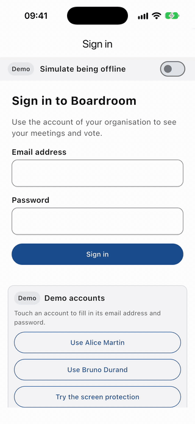
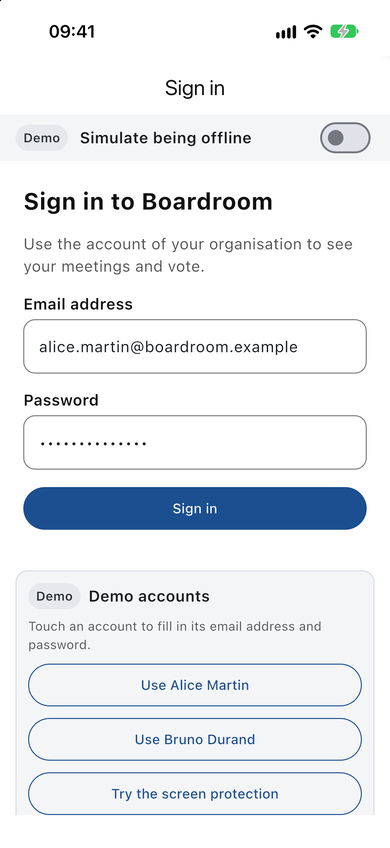
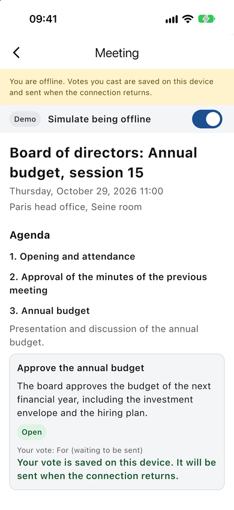
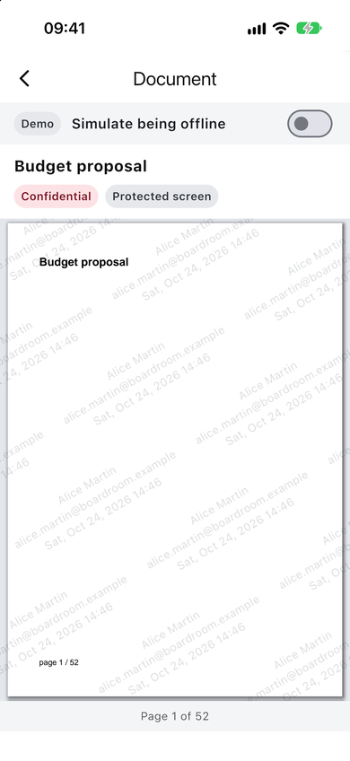
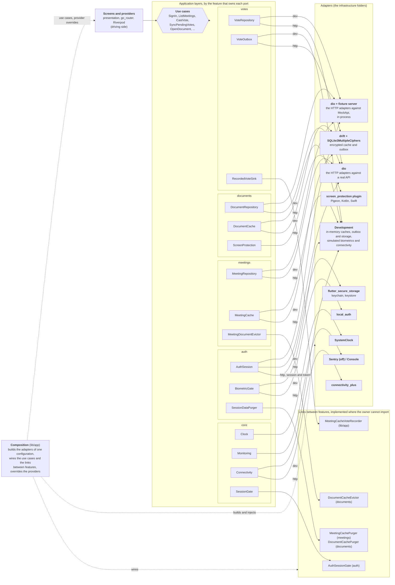

[](https://github.com/Rileyjrjohns/boardroom-flutter/actions/workflows/ci.yml)
[](https://github.com/Rileyjrjohns/boardroom-flutter/actions/workflows/e2e.yml)
[](https://github.com/Rileyjrjohns/boardroom-flutter/actions/workflows/release.yml)

# Boardroom (Flutter)

Boardroom is the Flutter port of [Boardroom (React Native)](https://github.com/Rileyjrjohns/boardroom): board-of-directors governance, where members read the papers of their meetings, vote on resolutions, and keep working when the network does not.
It has the same domain, the same use cases, the same ports and the same specification as the React Native app.
The showcase is the proof that a hexagonal, feature-first architecture makes the domain portable: the domain and application tests of the other app pass here under the same names (1146 scenarios, 0 differences), and only the adapters, the presentation and the tooling were written again. The server is simulated and the data is fictional.



| Sign-in                                                                  | Meeting                                                              | Offline vote                                                             | Protected document                                                                                      |
| ------------------------------------------------------------------------ | -------------------------------------------------------------------- | ------------------------------------------------------------------------ | ------------------------------------------------------------------------------------------------------- |
|  |  |  |  |

## Ports and adapters

The code is organised by feature (`lib/features/auth`, `meetings`, `documents`, `votes`, over a shared `lib/core`), and inside each by layer. The use cases know only ports, which are interfaces owned by the application layer of their feature (or of the core). An arrow from a port to an adapter reads "is implemented by"; `lib/app` is the one place that chooses the adapters of a configuration and the only one that knows every feature.



The features depend on each other along one graph and never in a cycle: `auth` on nothing, `meetings` on `auth`, `documents` and `votes` on both, everything on `core`, and a feature never imports another's infrastructure nor `lib/app`. `tool/check_imports.dart` fails the build otherwise. The detail is in [Architecture](docs/architecture.md), the decision in [ADR 0001](docs/adr/0001-feature-first-hexagonal-architecture-with-links-inverted-through-the-composition.md), and every port is specified in [docs/spec/ports.md](docs/spec/ports.md).

## Run it in 2 minutes

Prerequisites: Flutter 3.47.4 (pinned in `pubspec.yaml`), and Xcode (iOS) or Android Studio with an emulator (Android).

```sh
flutter pub get
dart run build_runner build      # freezed, json_serializable, drift and Riverpod code (not committed)
flutter run --dart-define=BOARDROOM_ADAPTERS=dev
```

That is the whole of the development configuration: no backend to start, no account to create, no network needed. The app talks to a simulated server **in the process** through its real HTTP adapters ([ADR 0007](docs/adr/0007-a-dio-fixture-server-as-the-dev-backend-and-the-http-mock.md)), and the sign-in screen offers two demo accounts: `alice.martin@boardroom.example` and `bruno.durand@boardroom.example`, both with the password `boardroom-demo`. A switch in the header takes the demo offline. The first run of a build downloads SQLite3MultipleCiphers (checked against a hash), and the path of the project should have no spaces. Everything else (the `http` configuration, the tests, the code generation) is in [Development](docs/development.md).

## React Native and Flutter, element by element

| Element                      | React Native (twin)                              | Flutter (this repository)                                                                     |
| ---------------------------- | ------------------------------------------------ | --------------------------------------------------------------------------------------------- |
| Server state                 | TanStack Query                                   | Riverpod `AsyncNotifier` and providers, with `keepQueryFor` (freshness 60 s, kept 5 min) and a `RetryPolicy` ([ADR 0002](docs/adr/0002-riverpod-rather-than-bloc.md)) |
| Client state                 | Zustand                                          | Riverpod notifiers                                                                            |
| Local storage                | expo-sqlite with SQLCipher                       | drift over SQLite3MultipleCiphers, one tables file per feature ([ADR 0003](docs/adr/0003-drift-rather-than-sqflite.md)) |
| HTTP mocks                   | MSW in the tests of the HTTP adapters; the demo runs on in-memory adapters and makes no request | A dio fixture server (`FixtureServerAdapter` over `MockApi`) for the dev build and the tests: the real HTTP adapters run in the demo ([ADR 0007](docs/adr/0007-a-dio-fixture-server-as-the-dev-backend-and-the-http-mock.md)) |
| End-to-end tests             | Maestro, six flows                               | Patrol, two flows (the reference scenarios) ([ADR 0005](docs/adr/0005-patrol-rather-than-integration-test-alone.md)) |
| Native module                | Expo Module (Swift, Kotlin)                      | Local plugin over Pigeon (Kotlin, Swift) ([ADR 0004](docs/adr/0004-pigeon-rather-than-a-raw-methodchannel.md)) |
| Build and delivery           | EAS, Fastlane as the alternative                 | Fastlane, gated on secrets ([ADR 0006](docs/adr/0006-fastlane-for-delivery.md))               |
| Dependency injection         | One composition root and a services context per feature | Riverpod overrides per feature, from `lib/app/providers/app_overrides.dart`               |
| Navigation                   | expo-router, typed routes                        | go_router, with a redirect driven by the access state                                         |
| i18n                         | i18next, typed keys                              | `gen-l10n` with ARB files (English and French), no literal in a screen (checked by a test)    |
| Lint and architecture checks | eslint-plugin-boundaries                         | `tool/check_imports.dart` and `very_good_analysis` ([ADR 0001](docs/adr/0001-feature-first-hexagonal-architecture-with-links-inverted-through-the-composition.md)) |
| Tests                        | Jest and React Native Testing Library            | `dart test` for the pure layers, `flutter_test` for adapters and screens, alchemist goldens   |
| Errors                       | `Result` type                                    | The same `Result`, sealed error families                                                      |
| Shared contract              | `docs/spec`, the source                          | `docs/spec`, a verbatim copy, and scenario parity ([ADR 0008](docs/adr/0008-shared-specification-and-scenario-parity-with-the-react-native-app.md)) |

## What changed and what did not

**Identical:** the domain, the use cases, the ports, the errors and their codes, the specification, the fixtures and the test scenarios. This is checked, not claimed: `tool/scenario_parity.dart` reads the test sources of the React Native repository at the commit pinned in `docs/parity/RN_COMMIT` and compares them with the Dart tests by name. The last run says `85 files, 1146 React Native scenarios, 1216 Dart tests, 0 with differences`, and CI runs it on every change. `test/tool/spec_conformance_test.dart` checks the specification against the Dart code (enumerations, error codes, use cases, ports, routes, demo data).

**Changed:** the adapters (dio, drift, the secure storage, `local_auth`, the Pigeon plugin), the presentation (widgets, Riverpod, go_router, gen-l10n) and the tooling (build_runner, Patrol, Fastlane, the import checker). The structure of the code is the same feature-first one, with the same four inversions between features.

**Forced by the language**, each decided and recorded in [open questions](docs/parity/open-questions.md): Dart has no union types, so the errors of a use case are a sealed family or `AppError` rather than a union; lower-casing an email differs from JavaScript on 467 code points (accepted); `trimText` follows JavaScript on U+0085; the `Duration` of the specification is `DurationMillis` and `VOTE_CHOICE.For` is `VoteChoice.forChoice`; and 6 contract scenarios about mutating an object cannot be written on immutable values ([exceptions](docs/parity/exceptions.md)). On iOS the secure view marks the whole Flutter view, not the child, because Flutter draws into one surface ([native module](docs/native-module.md)).

## Tests

| Level                                       | Runs on                         | Tests                              | What it proves                                                                           |
| ------------------------------------------- | ------------------------------- | ---------------------------------- | ---------------------------------------------------------------------------------------- |
| Domain, application, glue, tooling          | `dart test`, no Flutter         | 1,768 (54 skipped)                 | The business rules and the use cases, against fakes that pass the contract suites; the specification, the parity, the import rules, the links of the documents |
| Adapters and composition (`infrastructure`) | `flutter_test`                  | 2,706                              | dio against the fixture server, drift on an encrypted file, secure storage, the container in both configurations, the router and the shell |
| Screens (`presentation`)                    | `flutter_test`                  | 535                                | The screens of every feature and the shared components, over fakes                       |
| Goldens                                     | `flutter_test`, alchemist       | 6 images                            | The meetings list, the meeting detail and the document, in English and French, in three or four states each |
| End to end                                  | Android emulator, iOS simulator | 2 flows                             | [Patrol](https://patrol.leancode.co) on the built app: biometric login and a confidential document, an offline vote and its resync |

Coverage is measured on lines over all of `lib/` and has the gates of the React Native app: **90 percent** on `domain` and **90 percent** on `application` (each on its own), **70 percent** on the rest. The last run: 96.84 percent of 8,143 lines (domain 100 percent, application 99.67 percent, the rest 96.36 percent). `dart run tool/coverage_gate.dart` prints the table; CI shows it in the summary of the run. The commands are in [Development](docs/development.md#checks).

## Delivery

**Nothing is deployed from this repository.** The release pipeline (Fastlane, three GitHub Actions workflows) is written and tested but every step that signs or uploads is gated on store secrets that this repository does not have, so a tag runs the CI and skips both platform jobs. See [CI/CD](docs/ci-cd.md) and [Delivery](docs/delivery.md).

## Read on

- [Documentation index](docs/README.md): architecture, presentation, development, delivery, the HTTP API, the native plugin, monitoring.
- [Architecture decision records](docs/adr/README.md): eight short pages, from the feature-first architecture to the scenario parity with the React Native app.
- [The shared specification](docs/spec/README.md): the domain, the use cases, the ports, the screens and the demo data, independent of any framework.
- [Porting notes](docs/porting.md) and the [parity records](docs/parity/open-questions.md): how each file and test was translated, and where the two apps differ.
- The twin: [boardroom (React Native)](https://github.com/Rileyjrjohns/boardroom).
