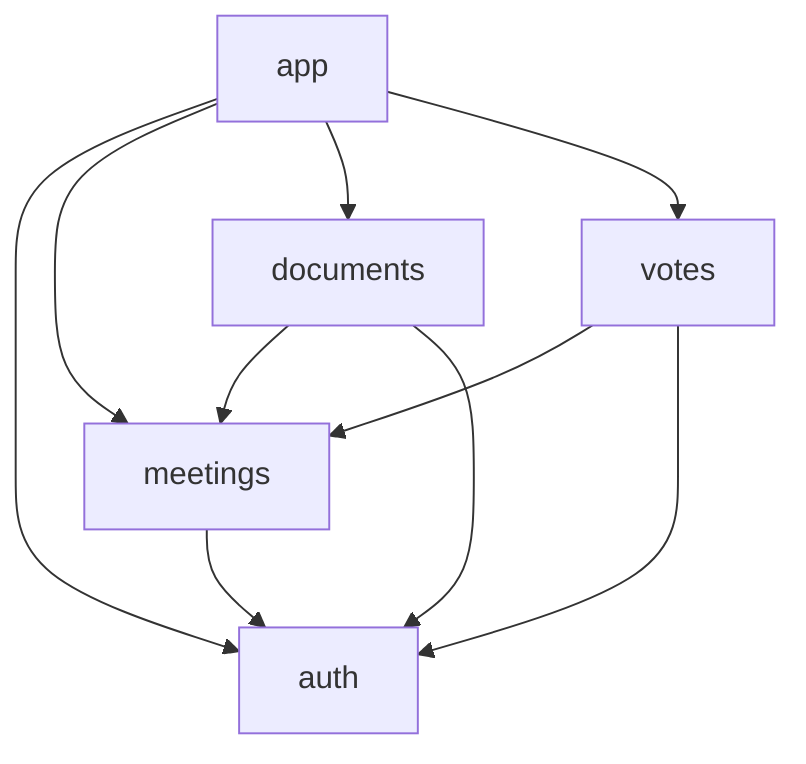

[](https://github.com/Rileyjrjohns/boardroom-flutter/actions/workflows/ci.yml)

# Boardroom (Flutter)

Board meetings, documents and votes: the Flutter port of Boardroom, built to show that a well-made hexagonal architecture lets the domain move from one framework to another.

Port of [Boardroom (React Native)](https://github.com/Rileyjrjohns/boardroom) with the same domain. Both apps follow the same specification, kept in [`docs/spec`](docs/spec).

Status: step 4 of 8, the screen protection plugin, done. The app shows a placeholder home screen with a way to a demo screen that tries the screen protection on a device; the domain and the application are translated, the adapters are written and tested (dio against the fixtures, the encrypted drift database, secure storage, biometrics, connectivity, monitoring), and the local plugin `packages/screen_protection` (Pigeon, Kotlin, Swift: [`docs/native-module.md`](docs/native-module.md)) is the native half of the `ScreenProtection` port. Nothing else is wired yet: the screens and the providers come in the next steps. How the code is translated, file by file and test by test, is written in [`docs/porting.md`](docs/porting.md); the infrastructure and the plugin are mapped in [`docs/parity/infrastructure.md`](docs/parity/infrastructure.md). The code is organised by feature, then by layer: see [Features and layers](#features-and-layers) and [`docs/architecture.md`](docs/architecture.md).

## Requirements

- Flutter 3.47.4 (stable), which ships Dart 3.13.3. The version is pinned in `pubspec.yaml` (`environment.flutter`).
- Xcode for iOS, Android Studio (or the Android SDK) for Android.

## Getting started

```sh
flutter pub get      # installs the dependencies and generates the localization classes
dart run build_runner build   # generates the freezed classes and the JSON code of the DTOs
flutter gen-l10n     # regenerates the localization classes by hand (after editing an ARB file)
flutter run          # runs the app on a connected device or emulator
flutter test         # runs all the tests
dart test test/core/domain test/core/application test/features/*/domain test/features/*/application test/app/composition test/support/fakes test/tool   # runs the pure Dart tests, without Flutter
```

## Generated code

Generated files are never committed. They are rebuilt with:

| What                                   | Command                                                    | Output                          |
| -------------------------------------- | ---------------------------------------------------------- | ------------------------------- |
| Localization classes (`AppLocalizations`) | `flutter gen-l10n` (also run by `flutter pub get`)       | `lib/l10n/app_localizations*.dart` |
| Freezed, JSON and drift code           | `dart run build_runner build` | `*.freezed.dart`, `*.g.dart`, `*.drift.dart` |

`flutter test` and `flutter analyze` do not regenerate the localization classes on their own: after a fresh clone, run `flutter pub get` first. The same goes for the freezed classes (the entities and value data of the `domain` folders of `lib/core` and `lib/features`): after a fresh clone, and after any change to a class annotated with `@freezed`, run `dart run build_runner build`, or `dart test` and `flutter analyze` fail on the missing `*.freezed.dart`. CI runs it before the analysis and the tests.
The drift code is generated in its modular form (`build.yaml`): each feature declares its tables, and the generator writes one `tables.drift.dart` beside each `tables.dart`, which the adapter of the feature and the database of `lib/app/persistence` import.
The texts live in `lib/l10n/app_en.arb` (English, the template and the fallback) and `lib/l10n/app_fr.arb` (French).

## Checks

[CI](.github/workflows/ci.yml) runs four jobs on every pull request and on every push to `main`. Run the same commands locally, from the root of the repository, after `flutter pub get` (and, for the last two jobs, `dart run build_runner build`). The infrastructure tests (`test/core/infrastructure`, `test/features/*/infrastructure`, `test/app` and `test/support/infrastructure`) run in their own step (`flutter test test/core/infrastructure test/features/*/infrastructure test/app test/support/infrastructure`) and again in the step `flutter test --coverage`: those that import Flutter or a plugin cannot run under `dart test`, so only the `domain` and `application` folders of `test/core` and `test/features/*`, the glue of `test/app/composition`, the fakes and the tooling run there.

**Import rules** (job `Import rules`): a file may only import what its layer allows, and a feature only the features that the graph names for it (see [Features and layers](#features-and-layers)).

```sh
dart run tool/check_imports.dart
```

**Analyze, format, tests, coverage** (job `Analyze, format, tests, coverage`):

```sh
dart run build_runner build   # the freezed classes, needed by the analysis and the tests
dart format --output=none --set-exit-if-changed .
flutter analyze --fatal-infos --fatal-warnings
dart test test/core/domain test/core/application test/features/*/domain test/features/*/application test/app/composition test/support/fakes test/tool   # pure Dart tests, no Flutter
flutter test test/core/infrastructure test/features/*/infrastructure test/app test/support/infrastructure   # the adapters: dio on the fixtures, drift, encrypted SQLite
flutter test test/features/*/presentation   # the screens
(cd packages/screen_protection && flutter test)   # the Dart side of the screen protection plugin
(cd android && ./gradlew :screen_protection:testDebugUnitTest)   # its Kotlin logic, on the JVM
(cd packages/screen_protection && dart run pigeon --input pigeons/screen_protection_api.dart && dart format lib && git diff --exit-code .)   # the generated channel is up to date
dart run tool/coverage_helper.dart       # writes test/coverage_helper_test.dart (ignored by Git)
flutter test --coverage                  # all the tests, writes coverage/lcov.info
dart run tool/coverage_gate.dart         # prints the coverage table, fails under a threshold
```

The coverage gate is on lines, the only figure that `flutter test --coverage` reports (the plugin is measured by its own tests, not by this gate). Generated files (`*.g.dart`, `*.freezed.dart`, `*.drift.dart` and the localization classes) are left out. The thresholds are the ones of the React Native repository:

| Scope                                                                      | Threshold |
| -------------------------------------------------------------------------- | --------- |
| domain: `lib/core/domain` and `lib/features/*/domain`                      | 90 %      |
| application: `lib/core/application` and `lib/features/*/application`      | 90 %      |
| everything else together (infrastructure, presentation, `lib/app`)         | 70 %      |

A layer with no code yet is not checked. `tool/coverage_helper.dart` imports every library of `lib/` in a generated test, so a file that no test loads counts as 0 % instead of being missing from the report. In CI the table is added to the summary of the run and `coverage/lcov.info` is uploaded as an artifact.

**Scenario parity with React Native** (job `Scenario parity with React Native`): the Flutter tests of the domain and of the application (the `domain` and `application` folders of `test/core` and `test/features/*`, `test/app/composition`, and the fakes in `test/support/fakes`) must be the tests of the React Native app, one for one, with the same names. The React Native repository is checked out at the commit written in [`docs/parity/RN_COMMIT`](docs/parity/RN_COMMIT).

```sh
git clone https://github.com/Rileyjrjohns/boardroom ../boardroom && git -C ../boardroom checkout "$(cat docs/parity/RN_COMMIT)"
dart run tool/scenario_parity.dart --rn ../boardroom                                   # every test file
dart run tool/scenario_parity.dart --rn ../boardroom --only src/core/domain/value-objects   # one folder
dart run tool/scenario_parity.dart --rn ../boardroom --only src/features/votes/application/use-cases --table   # the parity table of the use cases of a feature
```

The script reads the test sources of the feature-first layout of the React Native app (the `domain` and `application` folders of `src/core` and of `src/features/*`, `src/composition/glue`, and the tests of the fakes in `src/testing/application`), expands the `it.each` tables the way Jest does, runs `dart test --reporter json` to get the names of the Dart tests, and compares the full names file by file (the Dart test file of a React Native one is the single `<snake_name>_test.dart` among the pure test folders; when two share the name, the one in the folder of the same part of the code (`core` or the feature) and then of the same layer (`domain` or `application`); a file name shared by several features, `errors.test.ts`, is given its Dart name in `dartFileNames`; the mapping of the paths, the formation of the names and the translation of the assertions are in [`docs/porting.md`](docs/porting.md)). It fails on a scenario with no Dart test and on a Dart test with no scenario, unless [`docs/parity/exceptions.md`](docs/parity/exceptions.md) (a scenario that cannot exist in Dart) or [`docs/parity/extras.md`](docs/parity/extras.md) (a Dart-only test) explains it. The points where the specification was ambiguous, or where Dart forced a choice, are in [`docs/parity/open-questions.md`](docs/parity/open-questions.md).

The lint rules are those of `very_good_analysis` with `strict-casts`, `strict-inference` and `strict-raw-types`.

## Native libraries

The local database is encrypted at rest, with SQLCipher parameters and a key kept in the secure storage of the device, as in the React Native app. The library comes from the build hook of `package:sqlite3`, which `pubspec.yaml` asks for SQLite3MultipleCiphers (`hooks.user_defines.sqlite3.source: sqlite3mc`): the first build, test run or `dart run` downloads the prebuilt library for the platform (the download is checked against a hash that the package holds), so a developer or a CI runner installs nothing. `test/core/infrastructure/persistence/encrypted_sqlite_test.dart` opens an encrypted file on the machine that runs the tests, which proves the library encrypts. A database in memory takes no key, so tests that use one are plain.

## Monitoring

`ConsoleMonitoring` is the adapter in use. `SentryMonitoring` is written and tested but disabled, with no Sentry dependency; [`docs/monitoring.md`](docs/monitoring.md) says how to turn it on.

## Features and layers

The code is organised by feature (feature first), and inside each feature by layer (hexagonal). [`docs/architecture.md`](docs/architecture.md) has the layout, the graph of the features, the inversions that keep it without cycle and how CI enforces it.

| Folder                                      | Role                                                                                   |
| ------------------------------------------- | -------------------------------------------------------------------------------------- |
| `lib/core`                                  | The shared kernel: `Result`, the ids, `AppError` and the errors of the core, the clock, monitoring, connectivity, the offline policy, the HTTP client, the persistence machinery, the files and the secure storage; no business rule of a feature, and it imports no feature |
| `lib/features/auth`                         | The user, the session, the credentials, the app lock; sign in, sign out, restore the session, unlock; the session vault and the biometrics |
| `lib/features/meetings`                     | The meetings, their agenda, resolutions, participants and documents; the list and the detail; the repository and the cache |
| `lib/features/documents`                    | Opening a document, the watermark, the screen protection; the repository, the cache and the files |
| `lib/features/votes`                        | The votes and the outbox: cast, synchronise, list, acknowledge, discard; the repository and the outbox |
| `lib/app`                                   | The composition: it may import everything. The app and its home screen, `composition/` (the glue between features), `persistence/` (the drift database of the whole file and its migrations), `device/` (the seams of the phone) and `dev/` (the simulated world of the development build: the fixture server, the in-memory adapters that need the simulated server, the PDF writer) |

The features depend on each other in one direction only, and the graph has no cycle:



Every feature also depends on `core`, and `core` on no feature. A feature imports the `domain` and the `application` of the features it depends on, never their `infrastructure` nor their `presentation`. When a feature needs something of one it may not import, it declares a port and `lib/app` wires an implementation.

Inside `lib/core` and each feature, the layers are folders and follow the same rules:

| Layer            | Role                                                          | May import                                          |
| ---------------- | ------------------------------------------------------------- | --------------------------------------------------- |
| `domain`         | Business rules, pure Dart                                     | `domain`                                            |
| `application`    | Use cases and ports, pure Dart                                | `domain`, `application`                             |
| `infrastructure` | Adapters (dio, drift, secure storage, local_auth)             | `domain`, `application`, `infrastructure`; never `presentation` nor `lib/app` |
| `presentation`   | Widgets, screens, notifiers                                   | `domain`, `application`, `presentation`; never `infrastructure` |

`lib/main.dart` and `lib/app` may import anything. A Dart file outside `lib/core`, `lib/features/<feature>/<layer>`, `lib/app`, `lib/l10n` and `lib/main.dart` is refused.

Each of `lib/core`, `lib/features/<feature>` and `lib/app` has a `README.md` with the details.

`presentation` also never imports the packages behind the adapters (connectivity_plus, dio, drift, flutter_secure_storage, local_auth, path_provider, screen_protection, sqlite3), with one exception: `lib/features/documents/presentation/secure_content.dart` may import the widget of `screen_protection` (a native view cannot cross a port; [`docs/native-module.md`](docs/native-module.md)), `domain` and `application` use only pure Dart (see the allowlists in `tool/check_imports.dart`), and only the files that `flutter gen-l10n` writes are exempt in `lib/l10n`. `tool/check_imports.dart` enforces all of this, and the graph of the features with it: the constant `featureGraph` says which feature may import which, and why.
