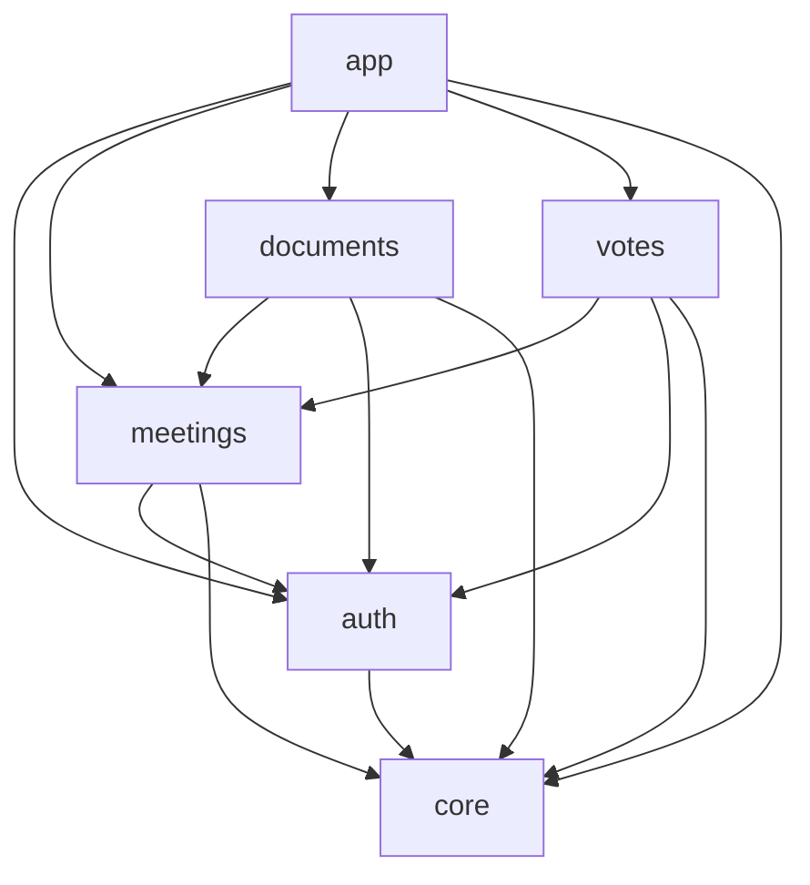

# Architecture

The code is organised **feature first**, and inside each feature **by layer** (hexagonal). The dependencies between features are few, go one way and have no cycle; where two features need each other, the one that owns the rule declares a port, the other implements it, and `lib/app` wires them. `tool/check_imports.dart` enforces all of it in CI.

The React Native app is still layered first (`src/domain`, `src/application`, `src/infrastructure`...), until its own refactor. The deviations from its structure are listed in [`parity/open-questions.md`](parity/open-questions.md), and the mapping of the files in [`porting.md`](porting.md).

## The layout

```text
packages/
  screen_protection/         the local plugin (Pigeon, Kotlin, Swift) behind the ScreenProtection port: docs/native-module.md
lib/
  main.dart                  the entry point: hands control to app
  l10n/                      the ARB files and the generated localizations
  core/                      the shared kernel: no rule of a feature
    domain/                    Result, ids, Instant, Page, AppError and its core families, policies
    application/               ports (Clock, Monitoring, Connectivity, SessionGate), the offline policy
    infrastructure/            the HTTP client, the persistence machinery, files, secure storage, clock
  features/
    auth/                    who the user is: the account, the session, the app lock
    meetings/                the meetings, their agenda, resolutions, participants and documents
    documents/               opening a document, the watermark, the screen protection
    votes/                   casting a vote, the outbox, synchronising it
      domain/  application/  infrastructure/  presentation/     the layers of every feature
  app/                       the composition: the only place that knows every feature
    composition/               the glue between features (pure Dart): the lists and the objects that wire the ports
    persistence/               the one drift database of the file, and the history of its migrations
    device/                    the seams of the phone (database engine, keychain, biometrics, network state)
    dev/                       the simulated world of the development build (fixture server, in-memory adapters)
```

Every folder of `lib/core`, `lib/features/<feature>` and `lib/app` has a `README.md` with the details.

## The features



An arrow is "may import". The graph is the constant `featureGraph` of `tool/check_imports.dart`, which also says why each edge exists.

- **`core` imports no feature and not `app`.** It holds what several features use and none owns. A rule of a feature does not go in `core` to dodge a cycle: the feature that owns it declares the port it needs.
- **A feature imports `core`, and the features the graph names for it, by their `domain` and `application` only.** Never their `infrastructure`, never their `presentation`: an adapter is chosen by the composition.
- **`app` imports everything**, and `main.dart` imports `app`. Nothing imports `app`.
- **There is no cycle** between features. The checker reads the graph as well as the imports, and fails if an edge closes a cycle.

## The layers inside a feature

`lib/core` has the same layers as a feature, with the same rules.

| Layer            | Holds                                                        | May import                                                                    |
| ---------------- | ------------------------------------------------------------ | ----------------------------------------------------------------------------- |
| `domain`         | Entities, value objects, policies, the errors of the feature | `domain`, pure Dart                                                           |
| `application`    | Use cases and ports                                          | `domain`, `application`, pure Dart                                            |
| `infrastructure` | Adapters (dio, drift, secure storage, local_auth)            | `domain`, `application`, `infrastructure`; never `presentation` nor `lib/app` |
| `presentation`   | Widgets, screens, notifiers                                  | `domain`, `application`, `presentation`; never `infrastructure`               |

A native plugin of the app lives in `packages/`, is a dependency by path like any other, and is an adapter package: only `infrastructure` and `app` import it. The one exception is a native *view*, which is an element of the widget tree and cannot cross a port: `lib/features/documents/presentation/secure_content.dart` may import the widget entry point of `screen_protection` (`presentationExemptions` in the checker, by file and by URI, tested).

`lib/app/composition` is a layer of its own, pure Dart like an application: it knows every feature and reaches the adapters through ports. The test fakes (`test/support/fakes`) may import it, so that the fakes assemble the same glue as the app instead of copying it.

## Inversions

When a feature needs something of one that the graph does not allow it to import, the dependency is inverted: **the feature that owns the policy declares the port it needs, another feature implements it, and only `lib/app` assembles them**.

| Owner     | Port it declares                                                                   | Who implements it                                                                                     | Where it is wired                                                                                                  |
| --------- | ---------------------------------------------------------------------------------- | ----------------------------------------------------------------------------------------------------- | ------------------------------------------------------------------------------------------------------------------ |
| `auth`    | `SessionDataPurger` (`features/auth/application/ports/session_data_purger.dart`): data a session leaves on the device, purged when the session ends | `meetings` (`MeetingCachePurger`), `documents` (`DocumentCachePurger`)                                | `lib/app/composition/session_data_purgers.dart` makes the ordered list that `purgeCaches` runs                      |
| `core`    | `SessionGate` (`core/application/ports/session_gate.dart`): what the offline policy asks of the session (who is signed in, end a session the server refused, purge) | `auth` (`AuthSessionGate`, over `requireSameUser`, `endRefusedSession` and `purgeCaches`)             | The deps of the use cases that load data carry it (`CacheFallbackDeps.sessionGate`); the composition builds it from the session guard of `auth` |
| `votes`   | `RecordedVoteSink` (`features/votes/application/ports/recorded_vote_sink.dart`): write a vote the server recorded into the local copy of its meeting | `lib/app/composition/meeting_cache_vote_recorder.dart` (`MeetingCacheVoteRecorder`: the cache of `meetings`, `withVoteRecorded` of `votes`, the session guard of `auth`) | The deps of `CastVote` and `SyncPendingVotes` carry it                                                              |
| `core`    | The retryable codes: `coreRetryableCodes` (`core/application/retryable_codes.dart`) | `documents` declares its own (`documentsRetryableCodes`)                                              | `lib/app/composition/retryable_codes.dart` assembles `retryableCodes`, the set of the specification                |
| `meetings`| `MeetingDocumentEvictor` (`features/meetings/application/ports/meeting_document_evictor.dart`): drop the documents of a meeting the server refuses | `documents` (`DocumentCacheEvictor`)                                                                  | The deps of `loadMeeting` carry it                                                                                  |

The first four are the inversions that remove the edges of the first layout; the last one is the same pattern for a rule that was hidden behind a shared deps interface. A port declared like this is Dart-only: the specification (`docs/spec`) does not know it, and the conformance test lists it (`_dartOnlyPorts` in `test/tool/spec_conformance_test.dart`).

The composition root that builds the use cases from these pieces comes with the providers (the next steps). Until then the glue is in `lib/app/composition` and `createFakes` (`test/support/fakes/create_fakes.dart`) assembles the same objects for the tests of the use cases.

Three other splits follow the same idea:

- **Errors.** `AppError` is an open base in `core` (`code`, `payload`, equality by class and data). The core keeps its families (repository, storage, validation); each feature declares its own as a family sealed in its own library: `AuthenticationError` and `BiometricError` in `auth`, `VotingError` and the delivery errors in `votes`, `ScreenProtectionError` in `documents`. A `switch` over a family is exhaustive; a `switch` over `AppError` itself cannot be, since its subclasses are in several libraries. The test that the codes are unique across the families is in `test/app`, the only place that sees them all.
- **Persistence.** Each feature owns its tables and the names of its tables, columns and indexes (`features/<feature>/infrastructure/persistence/tables.dart` and `schema.dart`), and its drift adapter works against a `GeneratedDatabase` and the tables it owns. `lib/app/persistence` keeps the database of the whole file, which lists the tables, and the history of the migrations, which reads the names of the features. The machinery of the core (`openProtectedDatabase`, `Migration`, `migrationStrategyOf`) knows no database of the app: the composition hands it the migrations and a factory. The split uses drift's modular code generation (`build.yaml`).
- **The device.** The bundle of the seams of a phone (`DevicePlatform`, `createDevicePlatform`) bundles adapters of `core` and of `auth`, so it is composition and lives in `lib/app/device`.

## How CI enforces it

The job `Import rules` runs `dart run tool/check_imports.dart`, which reads every import, export and part directive of `lib/` and `test/` with the Dart parser and fails, with one `file:line` per violation, when:

- a layer imports what it may not (the layer rules above, and the allowlists of Dart libraries and packages for `domain` and `application`);
- a file imports across features against `featureGraph`, imports the `infrastructure` or the `presentation` of another feature, or is in `core` and imports a feature or `app`;
- `featureGraph` names something that is no feature, a feature of `lib/features` is not in the graph, or the graph has a cycle;
- a pure test imports a test of another folder (a test of a feature may use `test/support` only);
- a file of the presentation imports the package of an adapter, except the exact file and URI of `presentationExemptions`.

`test/tool/check_imports_test.dart` tests every rule both ways (an allowed import passes, a forbidden one fails on the right line), a fabricated cycle included, and runs the checker on the real tree. To add a dependency between two features, add the edge to `featureGraph` with the reason; if it closes a cycle, invert it with a port instead.
