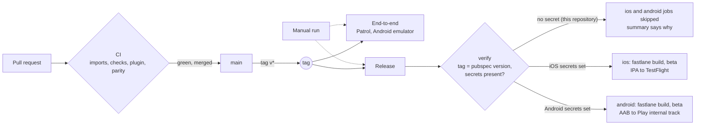

# CI/CD

Three workflows of GitHub Actions: [`ci.yml`](../.github/workflows/ci.yml) checks every change, [`e2e.yml`](../.github/workflows/e2e.yml) runs the two end-to-end flows on an Android emulator, and [`release.yml`](../.github/workflows/release.yml) builds and ships a version tag with Fastlane. **Nothing is deployed from this repository**: the release workflow is complete but skipped for lack of store secrets (see [Release](#release)).

## The workflows

| File                              | Runs on                              | What it does                                                                                                                                                                    |
| --------------------------------- | ------------------------------------ | ------------------------------------------------------------------------------------------------------------------------------------------------------------------------------- |
| `.github/workflows/ci.yml`        | Pull requests, pushes to `main`      | Four jobs in parallel: the import rules, the analysis, format, tests and coverage gate (with the goldens), the screen protection plugin, and the parity of the tests with React Native |
| `.github/workflows/e2e.yml`       | A tag `v*`, or by hand               | Builds the app and runs the two Patrol flows on an Android emulator (API 34) with the development configuration                                                                 |
| `.github/workflows/release.yml`   | A tag `v*`, or by hand               | Checks the tag, then builds the signed IPA and AAB and uploads them with Fastlane, per platform and only when that platform's secrets exist                                      |

Every workflow declares `permissions: contents: read`, pins each action to a major version, runs on a named runner (`ubuntu-24.04`, `macos-15`; GitHub began moving `ubuntu-latest` to Ubuntu 26 on 19 October 2026 and the runner should not change under the repository) and has timeouts on its jobs. `test/tool/release_test.dart` checks these rules, and the safety rules of the release.

## CI

The checks are the commands of the "Checks" section of the [README](../README.md), so anyone can run them locally. A new push to a branch cancels the run of the previous one (the group has the ref in it, so a pull request and `main` never cancel each other). No secret is used, so a pull request from a fork runs the same checks. The coverage table is added to the summary of the run, the coverage report and the images of a failed golden test are uploaded as artifacts.

## End-to-end

`e2e.yml` boots an Android emulator (`reactivecircus/android-emulator-runner`), and `patrol test --dart-define=BOARDROOM_ADAPTERS=dev` builds the app and the test app and runs the two flows of `integration_test/`. It takes several minutes, so it is not part of the CI of every pull request: it runs by hand and on a version tag. The flows and their setup are in the README ("End-to-end tests"). iOS is not run in CI (a macOS runner and a simulator for two flows cost more than they tell).

## Release

`release.yml` starts on a tag `v*` and by hand (`workflow_dispatch`). A second run for the same ref waits for the first (`cancel-in-progress: false`): an upload under way is never cut off. Three jobs:

- **`verify`** (Ubuntu, always run). On a tag, checks that it is the `version` of `pubspec.yaml` without its build number, or that version and a suffix for a candidate (`v1.0.0`, `v1.0.0-rc.1`), like the React Native workflow does for `app.config.ts`. Then turns the presence of the signing and store values of each platform into two outputs, `ios` and `android` (a secret cannot be read in the `if:` of a job), and writes in `$GITHUB_STEP_SUMMARY` which platform is released and which is skipped, with the names of the missing values. It never writes a value.
- **`ios`** (`macos-15`) and **`android`** (`ubuntu-24.04`), each with `if: needs.verify.outputs.<platform> == 'true'`. A job whose condition is false is *skipped*, not failed, and a skipped job starts no runner, so the expensive macOS minutes are not spent. When it runs: Flutter (the version of `pubspec.yaml`), Ruby with the locked gems (`bundler-cache`), `flutter pub get`, `dart run build_runner build`, then `bundle exec fastlane <platform> build` and `bundle exec fastlane <platform> beta` from the `ios/` or `android/` folder, and the IPA or the bundle kept as an artifact for 14 days. The secrets are given to the one step that needs them, as environment variables, and the lanes decode the base64 ones.

### Fastlane

One `fastlane/` folder per native project, as [docs.flutter.dev/deployment/cd](https://docs.flutter.dev/deployment/cd) shows, and one `Gemfile` at the root with Fastlane pinned to an exact version. The lanes are described in the README ("Delivery"). Their rules:

- All identity and secrets come from the environment, with no default: no team id, bundle identifier, password or key is written in the repository, and a test looks for them.
- A lane stops first, naming every missing variable. `ci_signing` and `beta` refuse to run outside CI unless `FORCE_DELIVERY=1`.
- The upload action appears once per platform, in `beta`, after the two checks above.
- iOS signing is explicit, not `match`: a distribution certificate (p12) and an App Store profile go into a temporary keychain, the Xcode project is switched to manual signing, and `flutter build ipa` takes an export options file that maps the bundle identifier to the profile. `match` needs a private repository for the certificates, which is one more secret store to run; the explicit way is enough for one app and is what the secrets already are. Authentication to App Store Connect is an API key, never an Apple ID and password.
- Android signing follows the Flutter documentation: `android/key.properties`, written by `ci_signing`, read by Gradle; the debug key stands in when the file is absent.

### What a tag does here

1. `verify` checks the tag against the version of `pubspec.yaml`.
2. `verify` finds no secret: `ios=false`, `android=false`, and the summary says `skipped, nothing is built or uploaded. Missing: ...` for each.
3. The `ios` and `android` jobs are skipped. The run is green. Nothing was signed, built or uploaded.

To ship for real, a project sets the values of the table "Secrets and variables" in the README, replaces the bundle identifier and the application id (`com.boardroom.flutterdemo`, a placeholder of the demo) with its own and makes the matching profile and Play Console entry. No change to the workflow or the lanes is needed. An ADR that compares Fastlane here with EAS in the React Native app belongs to step 8.
