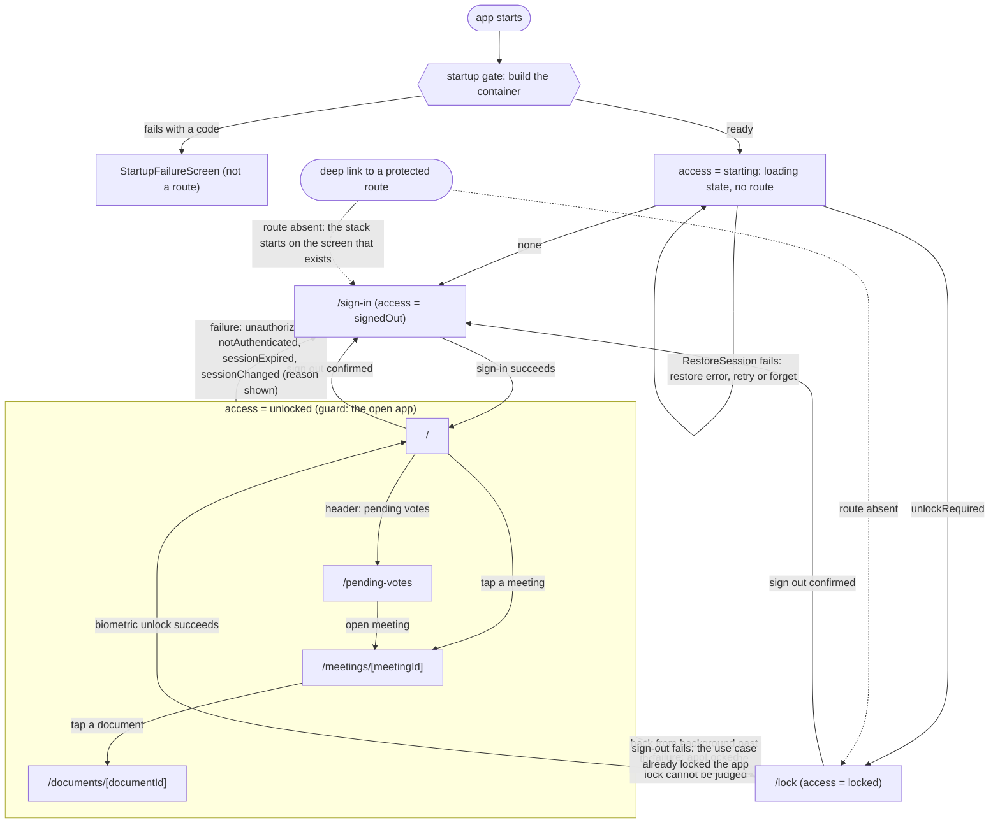

# Screens

The screens of Boardroom, what each one shows, the states it goes through, what the user can do and where it leads, and the stable test ids that identify its elements. This file is the presentation part of the specification: a Flutter version builds the same screens from it, on top of the use cases of [use-cases.md](use-cases.md), the ports of [ports.md](ports.md) and the domain of [domain.md](domain.md).

## How to read this file

- **Text is never written here.** The app speaks English and French. A user-facing text is named by its i18n key (for example `voting.queued`); the wording lives in the resource files. A Flutter version keeps the same keys. Where a key takes a parameter, the parameter is named after the key.
- **Codes, not texts, cross layers.** A screen receives a `Result` whose error is a code (see domain.md) and maps the code to a key. The mapping tables are part of the behaviour: they say which codes have a message of their own.
- **Dates and numbers** are formatted for the locale of the device. Three formatters exist: `dateTime` (compact: short weekday, day, short month, year, hour and minute), `fullDateTime` (the same with the weekday and month in full) and `number` (grouping of digits for counts). The domain holds an `Instant` with no time zone; the zone is the one of the device.
- **Screens read no clock.** Whatever depends on the time (is a voting window over?) is judged at `loadedAt`, the instant the use case answered with, and a screen that stays open past a closing time shows the state of its last load until it is refreshed.
- **Tables marked as checked.** Four kinds of table are read by the conformance test (`tooling/spec.test.ts`): the `Route` table, the `Test id` tables, the `Builder` table and the `Value` tables of the two presentation enumerations. The first cell of each of their rows is the identifier, in backticks. Every other table and all the prose are free text. The test compares the checked tables with the code in both directions, see [README.md](README.md).
- **Test ids** are identifiers a UI test or an end-to-end flow uses to find an element. A Flutter version sets the same strings as `Key` values, so the same flows run on both apps. They are stable: a change is a change of the spec.
- **Accessibility.** Every state change that matters (an error, a banner, a refresh, a vote outcome) is announced to the screen reader as a live region. Buttons carry a hint where the action is not obvious. Touch targets are at least 44 by 44 points. The content behind a dialog or the privacy cover is hidden from the screen reader.

## Routes

The app has six routes. The path is the one expo-router derives from the file under `app/`; a Flutter router uses the same paths so that a link means the same on both.

| Route                     | Parameters   | Screen                                   |
| ------------------------- | ------------ | ---------------------------------------- |
| `/`                       | -            | Meetings list (the home of the open app) |
| `/sign-in`                | -            | Sign-in form                             |
| `/lock`                   | -            | Lock screen                              |
| `/pending-votes`          | -            | Pending and rejected votes               |
| `/meetings/[meetingId]`   | `meetingId`  | Meeting detail, with the voting          |
| `/documents/[documentId]` | `documentId` | Document viewer                          |

Route files and the screens they mount (the route files only wire navigation callbacks and read the parameter, they hold no logic):

| File                             | Screen component    | Wiring                                               |
| -------------------------------- | ------------------- | ---------------------------------------------------- |
| `app/index.tsx`                  | MeetingsListScreen  | a tap on a row pushes `/meetings/[meetingId]`        |
| `app/sign-in.tsx`                | SignInScreen        | none                                                 |
| `app/lock.tsx`                   | LockScreen          | none                                                 |
| `app/pending-votes.tsx`          | PendingVotesScreen  | "open meeting" pushes `/meetings/[meetingId]`        |
| `app/meetings/[meetingId].tsx`   | MeetingDetailScreen | a tap on a document pushes `/documents/[documentId]` |
| `app/documents/[documentId].tsx` | DocumentScreen      | none                                                 |

Two things are **not routes**. The loading state of the start and the **startup failure** screen replace the whole app inside the startup gate, above the navigator, before any route exists. `app/_layout.tsx` (the root layout) and `app/+native-intent.tsx` (the filter of incoming links) are not screens either.

Route parameters come from outside, so a screen parses them with the domain before using them: `meetingId` with `parseMeetingId`, `documentId` with `parseDocumentId`. A missing or invalid parameter is shown as "not found", exactly like an id the server does not know.

The header title of each route is a key: `/` `navigation.meetings`, `/meetings/[meetingId]` `navigation.meeting`, `/documents/[documentId]` `navigation.document`, `/pending-votes` `navigation.pendingVotes`, `/sign-in` `navigation.signIn`, `/lock` `navigation.locked`. The header of the home route also carries the header actions (see "Header actions").

## Navigation map

### `ACCESS` - where the user stands

The navigator and every screen follow one piece of state, the access of the user. It is not derivable from the use cases (none reports the lock), so the presentation holds a mirror of it, moved by the outcome of the use cases and by the failures that end a session.

| Value       | Meaning                                                                                              |
| ----------- | ---------------------------------------------------------------------------------------------------- |
| `starting`  | `RestoreSession` has not answered yet. Only the loading state is shown, no route exists.             |
| `signedOut` | Nobody is signed in. Only `/sign-in` exists.                                                         |
| `locked`    | Somebody is signed in and the app is locked. Only `/lock` exists.                                    |
| `unlocked`  | The app is open. `/`, `/meetings/[meetingId]`, `/documents/[documentId]` and `/pending-votes` exist. |

The state also carries an **epoch**, a counter that goes up every time the access changes. Whatever starts under one access and answers later (a synchronisation, a check of the session, a failing request) reads the epoch when it starts and hands it back with its result; the result is applied only if the epoch is still the current one. An answer meant for the user who left is neither shown to the user who came after nor allowed to sign them out. Leaving `unlocked` forgets the sync summary and the reason of a session end; the store never holds a name, an email or a vote.

Every transition is guarded: it starts from the access it makes sense from and does nothing from any other.

| Transition        | Allowed from                | Result                                                                                       |
| ----------------- | --------------------------- | -------------------------------------------------------------------------------------------- |
| session restored  | `starting` only             | `none` gives `signedOut`; `unlockRequired` gives `locked`                                    |
| signed in         | `signedOut` only            | `unlocked`                                                                                   |
| unlocked          | `locked` only               | `unlocked`                                                                                   |
| locked(epoch)     | `unlocked`, same epoch only | `locked`                                                                                     |
| signed out        | any but `signedOut`         | `signedOut`                                                                                  |
| end session(code) | `unlocked`, same epoch only | `locked` if the code is `appLocked`, `signedOut` for every other code, with `sessionEndedBy` |

### Guards and the diagram

The navigator mounts a route only while its guard is true (a protected stack): the sign-in route exists for `signedOut` only, the lock route for `locked` only, and the other four for `unlocked` only. A route whose guard is false is **not in the stack at all**, which gives two guarantees a Flutter router must keep:

1. **No deep link reaches a protected route.** A link to a meeting, opened while the user is signed out or the app is locked, finds no such route and the stack starts on the screen that exists (sign-in or lock). Once the user is allowed in they land on `/`: the link is not remembered, because remembering where a link wanted to go would send whoever signs in next (another user, say) to a meeting they may not have.
2. **The back stack never returns to a protected screen.** When a guard turns false (a sign-out, a lock) its screens are removed from the stack, history included; when it turns true again the stack starts anew on its first screen (`/` for the open app).

The same meeting (or document) is never stacked twice: opening the meeting that is already open, or tapping a document row a second time before its screen has come up, goes to the screen that is open.

### Reading the diagram

- Leaving `unlocked` by any path empties everything the presentation holds in memory (the query cache), in the same update that removes the screens.
- `appLocked` is the only failure code that sends the user to `/lock`; the four others send them to `/sign-in`. The reason code is kept as `sessionEndedBy` and the destination screen shows it in its session notice (see "Session notice").
- For `notAuthenticated`, `sessionExpired` and `sessionChanged` the presentation also calls `SignOut`, so that a restart does not restore a session that is no longer valid. `unauthorized` is not signed out a second time (the application layer already ended that session when it met the server answer), and `appLocked` is not a session end.
- The lock screen and the sign-in screen are the only ones with a way out when the biometrics cannot be used: signing out.

### Session-ending codes

A failure that carries one of these codes, from a query, a mutation or a synchronisation, ends the session for the whole app, whichever screen was showing it. The codes are the ones of the application layer ([`SESSION_ENDING_CODES`](use-cases.md#session_ending_codes), see [the session policy](use-cases.md#the-session-policy)); the table says what the screens do with each.

| Error code         | Goes to    | Notice shown there        |
| ------------------ | ---------- | ------------------------- |
| `unauthorized`     | `/sign-in` | `errors.unauthorized`     |
| `notAuthenticated` | `/sign-in` | `errors.notAuthenticated` |
| `sessionExpired`   | `/sign-in` | `errors.sessionExpired`   |
| `sessionChanged`   | `/sign-in` | `errors.sessionChanged`   |
| `appLocked`        | `/lock`    | `errors.appLocked`        |

### Errors, retry and refusals

Every error shown by a list, a meeting or the outbox comes from one set of codes and one mapping to a key (`MEETINGS_ERROR_KEYS`). A rejection that is not the failure of a use case, or whose code has no key, is read as `unexpected`.

| Error code           | Key                         | Retry button | Other effect                                                |
| -------------------- | --------------------------- | ------------ | ----------------------------------------------------------- |
| `networkUnavailable` | `errors.networkUnavailable` | yes          |                                                             |
| `unexpected`         | `errors.unexpected`         | yes          |                                                             |
| `storageReadFailed`  | `errors.storageReadFailed`  | yes          |                                                             |
| `forbidden`          | `errors.forbidden`          | no           | the data the query held for the item is dropped from memory |
| `notFound`           | `errors.notFound`           | no           | the data the query held for the item is dropped from memory |
| `validation`         | `errors.validation`         | no           | a request that could not be built                           |
| `unauthorized`       | `errors.unauthorized`       | no           | ends the session                                            |
| `notAuthenticated`   | `errors.notAuthenticated`   | no           | ends the session                                            |
| `sessionExpired`     | `errors.sessionExpired`     | no           | ends the session                                            |
| `sessionChanged`     | `errors.sessionChanged`     | no           | ends the session                                            |
| `appLocked`          | `errors.appLocked`          | no           | ends the session (to the lock screen)                       |

**The retry rule.** A retry button is shown only for the codes that asking again can fix, the ones of the application layer ([`RETRYABLE_CODES`](use-cases.md#retryable_codes)): `networkUnavailable`, `unexpected`, `storageReadFailed`, and, for the document screen only, `screenProtectionFailed`. Every other code is final for the screen.

**Final versus inline.** An error with content already on screen:

- a retryable error is shown **inline** next to the content (a failed refresh, a failed next page), the content of the last success stays, and the inline error has its retry;
- a non-retryable error is **final** and replaces the content, whatever was loaded before.

### Freshness, retries and refresh (presentation memory)

These are the behaviours of the query layer in front of the use cases. They are tuning, not business rules, but a Flutter version that wants the same feel mirrors them.

- Data read by a screen counts as current for 60 seconds: a screen opened again inside the window shows what it has and asks nothing; after it, the screen shows what it has and revalidates in the background. Unused data is dropped from memory after 5 minutes.
- A failed read is tried again at most twice, only for the retryable codes ([a rule of the application layer](use-cases.md#the-session-policy)), after 0.5 s then 1 s (doubling, capped at 4 s). A mutation (sign in, vote, acknowledge, discard, sign out) is never retried.
- There is no refetch on focus or on reconnection: screens refresh on demand (pull to refresh, "Try again").
- A pull to refresh on the list restarts from the first page (the pages loaded beyond it are dropped and asked again as the user scrolls); on a meeting or the outbox it reads again. While refreshing, the screen announces `states.refreshing`.
- The whole memory cache is emptied whenever the user leaves `unlocked`, and when a failure ends the session.

### Session life of the open app

Four mechanisms in the shell, mounted once above the navigator, keep the access true:

| Mechanism             | Trigger                                                                                                                                              | Effect                                                                                                                                                                                    |
| --------------------- | ---------------------------------------------------------------------------------------------------------------------------------------------------- | ----------------------------------------------------------------------------------------------------------------------------------------------------------------------------------------- |
| Restore at start      | access is `starting`                                                                                                                                 | Calls `RestoreSession` once. On failure shows the restore failure (see below) and can ask again.                                                                                          |
| Connectivity          | from app start, needs no session                                                                                                                     | Calls `ObserveConnectivity`; stores the status (default `online`); each change to `online` asks for a vote synchronisation.                                                               |
| Background and return | app state `inactive` or `background`, then `active`                                                                                                  | Privacy cover up at once; remembers the instant of going to `background` (not of going `inactive`: the system biometric prompt makes the app inactive); on return runs `EvaluateAppLock`. |
| Session watch         | every `SESSION_CHECK_INTERVAL_MILLIS` (30 seconds, see [the session policy](use-cases.md#the-session-policy)) while `unlocked` and the cover is down | Calls `GetCurrentUser` as a check of the session. A session-ending failure ends the session; any other failure (the stored session cannot be read) locks the app: it fails closed.        |

On return from the background (only when the access is `unlocked`): `EvaluateAppLock` with the recorded instant; if the unlock is required, or the answer failed, the access becomes `locked`; otherwise the session is checked as above. The cover stays up until that is settled, then comes down, and a vote synchronisation is requested if the app is still open. A return from `inactive` that never went to `background` (a prompt closing, a pulled-down control centre) only lowers the cover.

**Vote synchronisation trigger** (one place decides). `SyncPendingVotes` is requested when the connection comes back, when the app returns to the foreground (after the lock and the session are settled), and when the access becomes `unlocked`. The request is dropped unless the access is `unlocked`; two runs never overlap (a request during a run is remembered and answered with one more run). A result is told only when something was sent or rejected: the counts are added to the sync summary of the banner, then the outbox and the meetings are asked again. A run interrupted by a session-ending code ends the session. A run answers for the epoch it started under, otherwise its answer is dropped.

## Sign-in

- **Route:** `/sign-in`. No parameters. Exists only while the access is `signedOut`.
- **Shows**, top to bottom: the connection banner (offline line only), the demo offline switch (demo configuration only), a scrolling form: a title (`signIn.title`, header role), a line `signIn.message`, the session notice when the user was sent here by a failure, an email field, a password field, a form error line, the submit button; then, under the form, the demo accounts (demo configuration only). The screen makes room for the keyboard on iOS; the form is at most the "form" width on large screens and centred.
- **Fields.** Email: label `signIn.email`, no capitalisation, no auto-correction, email keyboard, "next" moves to the password. Password: label `signIn.password`, secure entry, "go" submits.

### Behaviour

1. Submit does nothing while a sign-in is under way (the button, the "go" key, or both).
2. The form first checks the credentials with `createCredentials` (the domain rules: a well-formed email, a non-empty password), so a mistake is told next to its field without calling the server. The first refused field takes focus. The email message depends on the rule: `required` gives `signIn.emailRequired`, `tooLong` gives `signIn.emailTooLong`, every other rule gives `signIn.emailInvalid`. The password message is always `signIn.passwordRequired`.
3. A valid form dismisses the keyboard, clears the local refusal, **empties the password field whatever the answer will be**, and calls `SignIn` with the typed values. The password lives in the state of this screen only while it is typed; no other state of the app (a mutation, a store) holds it.
4. While the request is under way the fields are not editable and the button is busy (title `signIn.submitting`).
5. Typing in a field clears the local refusal (not a server failure).
6. On success the access becomes `unlocked` and the navigator shows `/`; nothing of the answer (the session, a name, an email) is kept.

### States

| State                  | Condition                                                         | What is shown                                                                                                           |
| ---------------------- | ----------------------------------------------------------------- | ----------------------------------------------------------------------------------------------------------------------- |
| Idle                   | nothing typed or nothing sent                                     | the form, the button enabled                                                                                            |
| Field error            | local refusal, or the use case answered `validation` with a field | the message under the email or password field                                                                           |
| Form error             | a failure that is not about a field                               | one live line above the button, from the table below                                                                    |
| Submitting             | a sign-in is under way                                            | fields disabled, button busy                                                                                            |
| Offline                | the device says it is offline                                     | the connection banner at the top (a sign-in cannot succeed); in the demo, the offline switch brings the connection back |
| Sent back by a failure | `sessionEndedBy` is set                                           | the session notice with the text of the code (see "Session notice")                                                     |

After a failure the password field is empty: focus goes to the email field if the failure is a validation on the email, else to the password field. There is no retry beyond submitting again.

| Failure code         | Where it is told                              | Key                                       |
| -------------------- | --------------------------------------------- | ----------------------------------------- |
| `validation`         | under the field named by the error; else form | rule keys above, else `errors.validation` |
| `invalidCredentials` | form error                                    | `errors.invalidCredentials`               |
| `networkUnavailable` | form error                                    | `errors.networkUnavailable`               |
| `unexpected`         | form error                                    | `errors.unexpected`                       |
| `storageWriteFailed` | form error                                    | `errors.storageWriteFailed`               |

### Actions

| Action                         | Effect                                                                                          |
| ------------------------------ | ----------------------------------------------------------------------------------------------- |
| Submit                         | as above; success navigates (by the guard) to `/`                                               |
| Touch a demo account           | fills the email and password fields with the account, clears the local refusal; does not submit |
| Toggle the demo offline switch | cuts or restores the simulated network (demo configuration only)                                |

### Test ids

| Test id                  | Constant              | Shown when                                 |
| ------------------------ | --------------------- | ------------------------------------------ |
| `sign-in-screen`         | `signInScreen`        | the screen is mounted (the root container) |
| `sign-in-email`          | `signInEmail`         | always: the email input                    |
| `sign-in-email-error`    | `signInEmailError`    | the email field has an error message       |
| `sign-in-password`       | `signInPassword`      | always: the password input                 |
| `sign-in-password-error` | `signInPasswordError` | the password field has an error message    |
| `sign-in-error`          | `signInError`         | a failure that is not about a field        |
| `sign-in-submit`         | `signInSubmit`        | always: the submit button                  |

## Lock

- **Route:** `/lock`. No parameters. Exists only while the access is `locked`.
- **Shows** nothing of the user (no name, no meeting): the connection banner (offline line only), the demo offline switch (demo configuration only), a title (`lock.title`), a line `lock.message`, the session notice when the user was sent here by a failure, the unlock error line when an unlock failed, an unlock button and a sign-out button.
- The unlock prompt is **not started on its own**: the user touches Unlock.

### States

| State                  | Condition                                         | What is shown                                                                                                                                           |
| ---------------------- | ------------------------------------------------- | ------------------------------------------------------------------------------------------------------------------------------------------------------- |
| Idle                   | just arrived                                      | title, message, the two buttons                                                                                                                         |
| Unlocking              | the biometric prompt is up or being prepared      | the unlock button busy (title `lock.unlocking`, hint `lock.unlockHint`)                                                                                 |
| Unlock failed          | `UnlockApp` returned an error                     | a live error line, one message per code (below); the button is enabled again                                                                            |
| Sent back by a failure | `sessionEndedBy` is set (for example `appLocked`) | the session notice                                                                                                                                      |
| Offline                | the device says it is offline                     | the connection banner                                                                                                                                   |
| Signing out            | the sign-out dialog is open                       | the dialog (see "Sign-out dialog"); the pending count is not known here, so it says in general terms that the votes are kept (`signOut.pendingUnknown`) |

| Unlock failure code    | Key                                 |
| ---------------------- | ----------------------------------- |
| `biometricUnavailable` | `unlockErrors.biometricUnavailable` |
| `biometricNotEnrolled` | `unlockErrors.biometricNotEnrolled` |
| `biometricCancelled`   | `unlockErrors.biometricCancelled`   |
| `biometricFailed`      | `unlockErrors.biometricFailed`      |
| `biometricLockedOut`   | `unlockErrors.biometricLockedOut`   |
| `unexpected`           | `errors.unexpected`                 |

The rule when the biometrics cannot be used (unavailable, not enrolled) is that **nothing else unlocks the app**: the only way forward is to sign out and sign in again, which is why signing out is always offered here.

### Actions

| Action   | Effect                                                                                                      |
| -------- | ----------------------------------------------------------------------------------------------------------- |
| Unlock   | calls `UnlockApp`; on success the access becomes `unlocked` and the guard shows `/`                         |
| Sign out | opens the sign-out dialog; confirming signs out, the access becomes `signedOut`, the guard shows `/sign-in` |

### Test ids

| Test id         | Constant      | Shown when                                 |
| --------------- | ------------- | ------------------------------------------ |
| `lock-screen`   | `lockScreen`  | the screen is mounted (the root container) |
| `lock-unlock`   | `lockUnlock`  | always: the unlock button                  |
| `lock-error`    | `lockError`   | the last unlock failed                     |
| `lock-sign-out` | `lockSignOut` | always: the sign-out button                |

## Meetings list

- **Route:** `/`. No parameters. Exists only while the access is `unlocked`. It is the first screen of the open app and the root of its stack.
- **Header:** title `navigation.meetings`, and the header actions (pending votes, sign out) on the right.
- **Shows**, top to bottom: the demo offline switch (demo configuration only), a segmented control with two options (Upcoming, Past), then the list of the selected period.
- **Period.** The selected period (`upcoming` by default) is kept in the interface store and survives opening a meeting and coming back. Each period has its own list: its own pages, pull in progress and scroll position, nothing of one shows on the other. Option labels `meetings.period.upcoming` and `meetings.period.past`; the control is a tab list labelled `meetings.period.label`.
- **Data.** `ListMeetings` with the period and a page request of `MEETINGS_PAGE_SIZE` (10) items, the cursor of the previous page for the next. The server decides which meetings are upcoming and which are past.
- **Row.** A button showing the title, the date and time (`dateTime` of `scheduledAt`) and the location. Hint `meetings.openHint`.
- **Banner area** above the list (`status-banner`): offline line, "saved data since" line when any page is stale (the oldest stale page's `cachedAt`), sync summary, local-data-reset notice. See "Status banner".

### States

| State            | Condition                                                    | What is shown                                                                                                                                            | Retry                                                        |
| ---------------- | ------------------------------------------------------------ | -------------------------------------------------------------------------------------------------------------------------------------------------------- | ------------------------------------------------------------ |
| Loading          | the first page is pending                                    | loading state labelled `meetings.loading`                                                                                                                | -                                                            |
| Initial error    | the first page failed, nothing to show                       | error state with the message of the code (table "Errors, retry and refusals")                                                                            | only for retryable codes; retry restarts from the first page |
| Empty            | no meetings, no error                                        | a centred message, `meetings.empty.upcoming` or `meetings.empty.past` according to the period                                                            | -                                                            |
| Content          | at least one meeting                                         | the rows                                                                                                                                                 | -                                                            |
| Loading more     | the next page is being fetched                               | a progress footer labelled `meetings.loadingMore`                                                                                                        | -                                                            |
| Next page failed | the next page failed (retryable code)                        | an inline error as the footer; automatic loading of further pages stops until the user presses retry                                                     | yes, fetches the next page                                   |
| End of list      | there are meetings and no next cursor                        | a footer message `meetings.endOfList`                                                                                                                    | -                                                            |
| Refresh failed   | a refresh failed (retryable code) and meetings are on screen | an inline error above the list, the rows stay                                                                                                            | yes, restarts from the first page                            |
| Stale            | any loaded page came from the saved copy                     | the banner says `states.staleData` with the date of the oldest saved page                                                                                | -                                                            |
| Offline          | the device says it is offline                                | the banner's offline line (`banner.offline`); independent of Stale: the device saying offline is a hint, a saved copy is what the server really answered | -                                                            |
| Session ended    | a non-retryable session-ending code                          | the whole app moves to `/sign-in` or `/lock` with the reason, and the list is gone with the rest                                                         | no                                                           |

The next page is requested when the end of the list is within half of the visible length, if there is a next cursor, no page is being fetched and the last page did not fail. A pull to refresh restarts from the first page.

### Actions

| Action                | Navigates / effect                                 |
| --------------------- | -------------------------------------------------- |
| Tap a row             | pushes `/meetings/[meetingId]` with the meeting id |
| Choose a period       | switches the list, no navigation                   |
| Pull down             | refresh from the first page                        |
| Scroll near the end   | loads the next page                                |
| Header: pending votes | pushes `/pending-votes`                            |
| Header: sign out      | opens the sign-out dialog                          |

### Test ids

| Test id                    | Constant                | Shown when                                                |
| -------------------------- | ----------------------- | --------------------------------------------------------- |
| `meetings-list`            | `meetingsList`          | the list of the selected period is mounted                |
| `meetings-loading`         | `meetingsLoading`       | the first page is pending                                 |
| `meetings-empty`           | `meetingsEmpty`         | no meetings and no error                                  |
| `meetings-error`           | `meetingsError`         | the first page failed                                     |
| `meetings-end`             | `meetingsEnd`           | the last page is loaded and there is at least one meeting |
| `meetings-loading-more`    | `meetingsLoadingMore`   | the next page is being fetched                            |
| `meetings-load-more-error` | `meetingsLoadMoreError` | the next page failed                                      |

## Meeting detail

- **Route:** `/meetings/[meetingId]`. Parameter `meetingId`, a meeting id. Exists only while the access is `unlocked`. Header title `navigation.meeting`. Pushed from the list or from a pending vote.
- **Data.** `GetMeeting` for the id; the voting state of every resolution needs two more reads, `GetCurrentUser` (who votes) and `ListPendingVotes` (what waits in the outbox), shared by all the resolutions of the screen.
- **Parameter handling.** A missing id or one `parseMeetingId` refuses is shown as not found, without asking the server.
- **Content** (a scrolling page with pull to refresh): banner area, demo offline switch, the inline errors, then
  1. the header: the title (header role), `fullDateTime` of `scheduledAt`, the location;
  2. the **Agenda** section (`meeting.agenda`): one block per agenda item, in position order, or `meeting.agendaEmpty`;
  3. the **Documents** section (`meeting.documents`): one row per document, or `meeting.documentsEmpty`;
  4. the **Participants** section (`meeting.participants`): one row per participant, or `meeting.participantsEmpty`.

### States

| State             | Condition                                                             | What is shown                                                                                                   | Retry                               |
| ----------------- | --------------------------------------------------------------------- | --------------------------------------------------------------------------------------------------------------- | ----------------------------------- |
| Loading           | the meeting is pending                                                | loading state labelled `meeting.loading`                                                                        | -                                   |
| Not found         | invalid parameter, or the server answered `notFound`                  | a centred message `errors.notFound`                                                                             | no                                  |
| Final error       | an error and (no data or a non-retryable code), other than `notFound` | error state with the message of the code (`forbidden` included)                                                 | only for retryable codes            |
| Content           | the meeting is loaded                                                 | the page above                                                                                                  | -                                   |
| Stale             | the meeting came from the saved copy                                  | the banner's "saved data since" line with the `cachedAt` date                                                   | -                                   |
| Offline           | the device says it is offline                                         | the banner's offline line                                                                                       | -                                   |
| Refresh failed    | a refresh failed with a retryable code, content on screen             | an inline error above the header; the meeting of the last success stays                                         | yes                                 |
| Votes unavailable | the user or the outbox could not be read                              | an inline error above the header with the code of the failure; the resolutions show no vote line and no choices | yes, asks again for what is missing |
| Session ended     | a session-ending code                                                 | the app moves to `/sign-in` or `/lock`                                                                          | no                                  |

A refusal of the item (`forbidden`, `notFound`) makes the screen drop the meeting it held, even if a refresh failed after a success.

### Agenda item and resolution

An agenda item block shows `meeting.agendaItem` with its `position` and `title`, then the optional description, then the resolution if there is one. A resolution is a card showing, in order:

1. the title and the description;
2. a badge for the **voting state at `loadedAt`**, from `getVotingState`: `open` gives `votingState.open`, `closed` gives `votingState.closed`, `windowOver` gives `votingState.windowOver`;
3. when `closesAt` exists, a line with the `dateTime` of it: `meeting.votingDeadline` while the state is `open`, `meeting.votingClosedOn` otherwise (the wording is neutral about whether the date is ahead or behind);
4. the vote line of the user: the recorded vote gives `meeting.resolutionYourVote` with the choice; else a vote waiting in the outbox gives `meeting.resolutionYourVoteQueued` with the choice; else `meeting.resolutionNoVote`. While the outbox or the user is not known (loading, unavailable) there is no vote line: saying "you have not voted" would be a guess;
5. the **voting block** (below), only when the vote of the user is known to the screen.

### `VOTE_VIEW` - the vote of the user on a resolution

This is what the voting block shows for one resolution. It is computed by `resolutionVoteView` from the meeting as loaded, the user, and the outbox (pending and rejected votes), at `loadedAt`.

| Value         | Meaning                                                                                                                          |
| ------------- | -------------------------------------------------------------------------------------------------------------------------------- |
| `loading`     | What decides it (who the user is, what waits in the outbox) is still being read. A progress indicator labelled `voting.loading`. |
| `unavailable` | It could not be read. Nothing is said about the vote and nothing can be cast; the screen shows the inline votes error instead.   |
| `eligible`    | The user may vote now. The three choices are offered.                                                                            |
| `queued`      | The user voted and the vote waits in the outbox to be sent. Shown as `voting.queued`, with the choice in the vote line.          |
| `rejected`    | The user's vote was refused or given up and not yet acknowledged. The reason and an acknowledge button are shown.                |
| `ineligible`  | The user may not vote and the rule says why. A text, no control that would do nothing.                                           |

**Precedence** (most urgent first, the first match wins, `resolutionVoteView`):

1. the outbox holds a **rejected** vote of the user on this resolution: `rejected` (it blocks a new vote, and the user must see why);
2. the outbox holds a **pending** vote on it: `queued`, with its choice, whether or not the rule would let them vote now (the server judges it again when it is sent);
3. `checkVotingEligibility` with an empty list of queued votes (a queued one was answered above): success gives `eligible`; an error gives `ineligible` with that voting error. When the error is `noVotingRights`, the role of the user in the meeting is carried so the text can name it;
4. while the user or the outbox is still being read: `loading`; if either read failed: `unavailable`.

The rule itself is not written in the screen: it is the eligibility policy of domain.md, the one `CastVote` applies, run on the loaded meeting.

### Voting block, by view

| View          | What is shown                                                                                                                                                                                                                                                                                                                                                                                                       |
| ------------- | ------------------------------------------------------------------------------------------------------------------------------------------------------------------------------------------------------------------------------------------------------------------------------------------------------------------------------------------------------------------------------------------------------------------- |
| `loading`     | progress indicator (`voting.loading`)                                                                                                                                                                                                                                                                                                                                                                               |
| `unavailable` | nothing                                                                                                                                                                                                                                                                                                                                                                                                             |
| `queued`      | a live line `voting.queued` that stays for as long as the vote waits; it goes when the vote is sent or refused (the view changes)                                                                                                                                                                                                                                                                                   |
| `eligible`    | a heading `voting.choose` and three secondary buttons in this order: For (`voteChoice.for`), Against (`voteChoice.against`), Abstain (`voteChoice.abstain`), one under the other, each as wide as the screen; hint `voting.choiceHint`                                                                                                                                                                              |
| `rejected`    | a live line `voting.rejected` with the reason, then the acknowledge button                                                                                                                                                                                                                                                                                                                                          |
| `ineligible`  | a text: for `noVotingRights` with a known role `voting.noVotingRightsAs` with the role label (`participantRole.*`); otherwise the text of the voting error: `resolutionNotFound`, `notAParticipant`, `noVotingRights`, `resolutionClosed`, `votingWindowOver` map to `voting.reason.<code>`; `alreadyVoted` is `voting.reason.alreadyVotedRecorded` or `voting.reason.alreadyVotedQueued` according to its `source` |

The reason of a rejected vote is the voting-error text above, or, for `voteUndeliverable`, `voting.reason.voteUndeliverable` with the number of attempts (plural-aware count).

### Casting a vote

1. Touching a choice resets the previous cast state, clears the outcome line, and opens the **vote dialog** with that choice.
2. Confirming calls `CastVote` (which itself asks for the biometric proof). Cancel or the back gesture close the dialog; both are disabled while the cast is pending, so one tap casts one vote.
3. On success, the queries that show the vote are asked again and the screen waits for their answer before it closes the dialog, so the new state is already there:
   - `submitted`: the meeting and the outbox are read again; the outcome line `voting.submitted` is shown (live) and outlives the choices, which are gone because the meeting now carries the vote;
   - `queued`: only the outbox is read again; no outcome line is set (the `queued` view says it for as long as it is true).
4. A refusal by the rules (a voting error, or `votePreviouslyRejected`) also reads the meeting and the outbox again, because it tells something new about them (the resolution closed, the user voted elsewhere).
5. Nothing is shown before the use cases answered: there is no optimistic vote.

### Vote dialog

A modal with the title `voting.confirmTitle`. Contents, top to bottom:

1. the title of the resolution;
2. the choice under review, `voting.confirmChoice` with the choice label;
3. `voting.confirmFinal`: the vote is final;
4. `voting.confirmBiometric`: a biometric confirmation follows;
5. when the device says it is offline, `voting.confirmOffline`: the vote will be saved and sent later;
6. when the last attempt failed, a live error line with the text of the failure: `alreadyVoted` by its `source` (`voting.reason.alreadyVotedRecorded` or `...Queued`), any other code from the cast-failure map (session codes `errors.*`, repository codes `errors.*`, `storageWriteFailed` gives `voting.failure.storageWriteFailed`, voting reasons `voting.reason.*`, biometric codes `voteBiometric.<code>`, `voteInProgress` gives `voting.failure.voteInProgress`, `votePreviouslyRejected` gives `voting.failure.votePreviouslyRejected`).

Actions: **Cancel** (secondary, disabled while pending) and **Confirm** (busy while pending, title `voting.confirming`). When the failure is **final for this vote**, both are replaced by a single **Close** button.

**Retryable by the user.** After a failure, Confirm stays available (the choice is still under review) when trying again can help, that is for the retryable codes (`networkUnavailable`, `unexpected`, `storageReadFailed`, `screenProtectionFailed`) and for `biometricCancelled`, `biometricFailed`, `biometricLockedOut` and `storageWriteFailed` (the vote could not be saved). Every other code is final for this vote (the resolution closed, the user voted elsewhere, the device cannot do biometrics, the session is over, a rejected vote is waiting to be acknowledged): only Close remains.

### Documents and participants rows

- **Document row** (the whole row is a button): the title, a badge with the confidentiality (`confidentiality.public`, `confidentiality.internal`, `confidentiality.confidential`, each with its own tone) and the page count (plural key `meeting.pageCount`). The accessible name says all three facts (`meeting.documentLabel`); hint `meeting.openDocumentHint`. Tapping pushes `/documents/[documentId]`.
- **Participant row** (not a button): the full name and the role label (`participantRole.chair`, `.secretary`, `.member`, `.guest`).

### Actions

| Action                        | Navigates / effect                                                  |
| ----------------------------- | ------------------------------------------------------------------- |
| Tap a document row            | pushes `/documents/[documentId]`                                    |
| Pull down                     | reads the meeting again                                             |
| Retry (inline or final error) | reads again what failed                                             |
| Tap a vote choice             | opens the vote dialog                                               |
| Acknowledge a rejected vote   | see "Acknowledge button"                                            |
| Back                          | pops to the previous screen (the list, or the pending votes screen) |

### Test ids

| Test id                | Constant              | Shown when                                                         |
| ---------------------- | --------------------- | ------------------------------------------------------------------ |
| `meeting-detail`       | `meetingDetail`       | the meeting is loaded (the scrolling container)                    |
| `meeting-loading`      | `meetingLoading`      | the meeting is pending                                             |
| `meeting-error`        | `meetingError`        | a final error other than not found                                 |
| `meeting-not-found`    | `meetingNotFound`     | the parameter is invalid, or the meeting does not exist            |
| `meeting-title`        | `meetingTitle`        | the meeting is loaded (the header title)                           |
| `agenda-section`       | `agendaSection`       | the meeting is loaded                                              |
| `documents-section`    | `documentsSection`    | the meeting is loaded                                              |
| `participants-section` | `participantsSection` | the meeting is loaded                                              |
| `voting-loading`       | `votingLoading`       | a resolution whose vote view is `loading`                          |
| `voting-error`         | `votingError`         | the votes of the meeting are unavailable (inline error at the top) |

### Test ids of the vote dialog

| Test id               | Constant            | Shown when                                    |
| --------------------- | ------------------- | --------------------------------------------- |
| `vote-dialog`         | `voteDialog`        | the dialog is open                            |
| `vote-dialog-choice`  | `voteDialogChoice`  | a choice is under review                      |
| `vote-dialog-final`   | `voteDialogFinal`   | always in the open dialog                     |
| `vote-dialog-offline` | `voteDialogOffline` | the device says it is offline                 |
| `vote-dialog-error`   | `voteDialogError`   | the last attempt failed                       |
| `vote-confirm`        | `voteConfirm`       | the failure (if any) is retryable by the user |
| `vote-cancel`         | `voteCancel`        | the failure (if any) is retryable by the user |
| `vote-close`          | `voteClose`         | the failure is final for this vote            |

## Document

- **Route:** `/documents/[documentId]`. Parameter `documentId`, a document id. Exists only while the access is `unlocked`. Header title `navigation.document`. Pushed from a document row.
- **Parameter handling.** A missing id or one `parseDocumentId` refuses is shown as not found (`document.notFound`), without opening anything.
- **Not a query.** Opening a document does something: it turns the screen protection on, counts a view and logs the access. So the screen runs a **lifecycle**, not a cached read: `OpenDocument` when the screen starts being shown, `CloseDocument` when it stops, exactly one close for each successful open. The document is held in the state of the screen only and goes with it; nothing of it (location, reader name) stays in a cache.
- **Lifecycle.** The document is open while the screen is the one the user is looking at (it has focus) **and** the access is `unlocked`. It is released as soon as either stops being true: the user goes back, another screen is put over this one, the app locks, the user signs out, the session ends. An open that completes after the screen has stopped is released immediately (otherwise its view would stay counted and the protection with it). Retrying runs the lifecycle again from the start. A session-ending failure of the open ends the session for the app.
- **Capture watch.** While the screen is shown, `ObserveScreenCapture` is subscribed; it stops with the screen. See "Capture notice".

### States

| State         | Condition                                      | What is shown                                                                                              | Retry                         |
| ------------- | ---------------------------------------------- | ---------------------------------------------------------------------------------------------------------- | ----------------------------- |
| Not found     | invalid parameter                              | a centred message `document.notFound`                                                                      | no                            |
| Loading       | `OpenDocument` is under way                    | loading state labelled `document.loading`                                                                  | -                             |
| Failed        | `OpenDocument` returned an error               | the message of the code (below), live                                                                      | only for retryable codes      |
| Ready         | opened                                         | the document (below)                                                                                       | -                             |
| Stale         | opened from the saved copy (`source` is stale) | the banner's "saved data since" line with `cachedAt`; the screen is protected (see below)                  | -                             |
| Offline       | the device says it is offline                  | the banner's offline line; a document never viewed cannot be opened (`document.errors.networkUnavailable`) | -                             |
| PDF loading   | the file is being read                         | a veil labelled `document.rendering` over the page area, inside the secure container                       | -                             |
| PDF failed    | the viewer could not read or draw the file     | a message `document.renderFailed` (live) and a retry button; the page indicator is hidden                  | yes, opens the document again |
| Covered       | the privacy cover is up                        | an empty page area; the PDF view is **not mounted** (see "PDF viewer lifecycle")                           | -                             |
| Capture seen  | a screenshot or a recording was reported       | the capture notice at the top                                                                              | -                             |
| Session ended | a session-ending code                          | the app moves to `/sign-in` or `/lock`                                                                     | no                            |

| `OpenDocument` error code     | Key                                           | Retry                |
| ----------------------------- | --------------------------------------------- | -------------------- |
| `networkUnavailable`          | `document.errors.networkUnavailable`          | yes                  |
| `forbidden`                   | `document.errors.forbidden`                   | no                   |
| `notFound`                    | `document.notFound`                           | no                   |
| `unexpected`                  | `errors.unexpected`                           | yes                  |
| `storageReadFailed`           | `errors.storageReadFailed`                    | yes                  |
| `screenProtectionUnsupported` | `document.errors.screenProtectionUnsupported` | no                   |
| `screenProtectionFailed`      | `document.errors.screenProtectionFailed`      | yes                  |
| `unauthorized`                | `errors.unauthorized`                         | no, ends the session |
| `notAuthenticated`            | `errors.notAuthenticated`                     | no, ends the session |
| `sessionExpired`              | `errors.sessionExpired`                       | no, ends the session |
| `sessionChanged`              | `errors.sessionChanged`                       | no, ends the session |
| `appLocked`                   | `errors.appLocked`                            | no, ends the session |

`networkUnavailable` is told apart on purpose here: when opening a document, it means the document is not on the device, so the user is told why it cannot be read offline and not only that the server is out of reach. A document that does not exist or that the user may not have is told as a document, not as a meeting.

### The opened document

- **Header:** the title (header role), then a badge with the confidentiality (same keys and tones as the document row), then, only when `screenProtected` is true, a badge `document.protectedBadge`.
- **Pages area**, in this order of layers, inside one **secure container** when `screenProtected` is true (on iOS, left out of screenshots; on Android the window flag of the screen protection does it; with protection off the container is plain):
  1. the PDF view, drawn from the location the use case returned, with annotations and links disabled (a link in a document goes nowhere), fitting the width; it reports the page count when loaded, each page change, and failure;
  2. the loading veil while the file is being read;
  3. the **watermark** over everything.
- **Page indicator** below the pages, outside the secure container, shown once the file is read: `document.pageIndicator` with the current page and the total (both through `number`), a polite live region. The page starts at 1 when loaded and follows the page changes of the viewer.
- The pages area is **remounted for each file** (keyed by the location): a document opened again starts from the first page, loading.

### The protection rule

`screenProtected` is true when the document is **confidential OR was served from the saved copy**. A saved copy can be older than the last change of the classification of the document (it may have been public when it was saved), so the level stored with the copy is not trusted. The rule fails closed: if the protection cannot be enabled, the document is not returned at all (the failure is one of the codes above). The protected badge, the secure container and the platform protection all follow the same flag.

### Watermark

Every document carries the watermark, **protected or not**: the protection and the badge follow the classification, but the name of the reader on a page deters a photograph of any document.

- **Content** (decided by the domain, `Watermark`): the full name and the email of the signed-in reader, and the instant the document was opened (`viewedAt`). The text of one tile is these three lines, in this order, separated by line breaks: full name, email, `dateTime(viewedAt)`.
- **Layout** (decided here):

| Parameter      | Value                                                                              |
| -------------- | ---------------------------------------------------------------------------------- |
| Tile width     | 240 points                                                                         |
| Tile height    | 96 points                                                                          |
| Angle          | -30 degrees (negative rises to the right)                                          |
| Opacity        | 0.16                                                                               |
| Font size      | 13 points                                                                          |
| Text colour    | `#1f2933` (dark; faint through the opacity)                                        |
| Text alignment | centred, horizontally and vertically; at most 3 lines; horizontal padding 8 points |

- **Tiling.** Let the area be the size of the pages area (measured once laid out; until then the size of the window, which it cannot exceed, so the page is never shown bare). The diagonal is `ceil(hypot(width, height))`. Tiles are laid in a square of side `diagonal`, centred on the area and rotated by the angle, so that after the rotation they still cover every corner. Rows: `ceil(diagonal / tileHeight)`. Columns: `ceil(diagonal / tileWidth) + 1` (one more than fits, for the shifted rows). Odd rows (0-based index 1, 3, ...) are shifted left by half a tile so a whole line of text does not stand in the same column down the page. The overflow is clipped to the area.
- **Behaviour.** The overlay takes no touch (the page under it scrolls, zooms and follows links as if it were not there) and is hidden from screen readers (a name and an email repeated forty times says nothing to someone who cannot see the page).

### PDF viewer lifecycle

The PDF view is **mounted only while the app is active**. The privacy cover is up from the moment the app goes inactive or to the background and stays up on the way back until the lock has been judged, so it is the signal: while it is up the native view is unmounted (an empty page area is shown in its place), and it is mounted again, from the first page, when the cover is lifted. On Android the native view renders pages again when the app resumes; if the lock removes the screen at the same moment, it would render on a document that is already closed, which kills the app. A locked app removes this screen, so nothing mounts again for it.

### Capture notice

A strip at the top of the screen, on the warning background, shown after the system reports a capture: `document.capture.screenshot` for a screenshot, `document.capture.recording` for the start of a recording. The end of a recording says nothing new and shows nothing. The tone is calm: it states what happened, it does not accuse. It is announced to the screen reader when it appears and again for each new capture (each notice carries a sequence number so two identical words are announced twice). A **Dismiss** button (`banner.dismiss`) hides it. The use case also logs the event with the document id and the user id, nothing else.

### Actions

| Action                 | Navigates / effect                                    |
| ---------------------- | ----------------------------------------------------- |
| Retry (error state)    | runs the lifecycle again                              |
| Retry (PDF failed)     | opens the document again (a new open and a new close) |
| Dismiss capture notice | hides the notice                                      |
| Back                   | pops to the meeting; the document is released         |

### Test ids

| Test id                    | Constant                 | Shown when                                                                |
| -------------------------- | ------------------------ | ------------------------------------------------------------------------- |
| `document-screen`          | `documentScreen`         | the viewer is mounted (the root container, not for the not found message) |
| `document-not-found`       | `documentNotFound`       | the parameter is invalid                                                  |
| `document-loading`         | `documentLoading`        | `OpenDocument` is under way                                               |
| `document-error`           | `documentError`          | `OpenDocument` failed                                                     |
| `document-title`           | `documentTitle`          | the document is opened                                                    |
| `document-protected-badge` | `documentProtectedBadge` | the document is opened and `screenProtected` is true                      |
| `document-pdf`             | `documentPdf`            | the PDF view is mounted (not while covered)                               |
| `document-pdf-loading`     | `documentPdfLoading`     | the file is being read                                                    |
| `document-pdf-error`       | `documentPdfError`       | the viewer could not read or draw the file                                |
| `document-page-indicator`  | `documentPageIndicator`  | the file is read                                                          |
| `document-watermark`       | `documentWatermark`      | the pages area is shown (overlay container)                               |
| `document-watermark-tile`  | `documentWatermarkTile`  | one per tile of the watermark                                             |
| `document-secure-content`  | `documentSecureContent`  | the pages area is shown (the secure container, protected or not)          |
| `document-capture-notice`  | `documentCaptureNotice`  | a screenshot or a recording start was reported                            |
| `document-capture-dismiss` | `documentCaptureDismiss` | the capture notice is shown                                               |

## Pending votes

- **Route:** `/pending-votes`. No parameters. Exists only while the access is `unlocked`. Header title `navigation.pendingVotes`. Pushed from the header of the list.
- **Data.** `ListPendingVotes`: the votes of the signed-in user that are not settled. The votes are sent by the synchronisation, **never from this screen**; the screen shows what waits and what became of it, and a pull asks the outbox again.
- **Shows** (a scrolling page with pull to refresh): banner area (offline line, sync summary, reset notice; never a stale line, there is no saved copy of the outbox), demo offline switch, the inline refresh error, an explanation (`pendingVotes.explanation`), the unreadable votes notice when the count is above zero, the empty message, then up to two sections.
- **Sections.** Waiting (`pendingVotes.waiting`), shown when there is at least one pending vote; Rejected (`pendingVotes.rejected`), shown when there is at least one rejected vote. Rows are oldest first, one per vote.
- **Row.** A card for one vote: the line `meeting.resolutionYourVote` with the choice, the line `pendingVotes.castAt` with `dateTime(castAt)`. A rejected vote also shows the reason (the voting-error text, or `voting.reason.voteUndeliverable` with the attempts), `pendingVotes.rejectedAt` with `dateTime(rejectedAt)`, and the acknowledge button. Every row ends with a secondary button `pendingVotes.openMeeting` that opens the meeting the vote is about (the outbox holds ids, not titles, so the row leads to the meeting where the resolution is).

### States

| State              | Condition                                                | What is shown                                                                                           | Retry                    |
| ------------------ | -------------------------------------------------------- | ------------------------------------------------------------------------------------------------------- | ------------------------ |
| Loading            | the outbox read is pending                               | loading state labelled `pendingVotes.loading`                                                           | -                        |
| Final error        | an error and (no data or a non-retryable code)           | error state with the message of the code                                                                | only for retryable codes |
| Empty              | no pending and no rejected vote                          | a centred message `pendingVotes.empty` (the explanation and a notice for unreadable entries still show) | -                        |
| Content            | at least one vote                                        | the sections                                                                                            | -                        |
| Refresh failed     | a refresh failed (retryable code) with content on screen | an inline error above the explanation; the votes of the last success stay                               | yes                      |
| Unreadable entries | the count of unreadable entries is above zero            | the unreadable votes notice                                                                             | -                        |
| Offline            | the device says it is offline                            | the banner's offline line                                                                               | -                        |
| Session ended      | a session-ending code                                    | the app moves to `/sign-in` or `/lock`                                                                  | no                       |

### Actions

| Action                 | Navigates / effect                                             |
| ---------------------- | -------------------------------------------------------------- |
| Open meeting (a row)   | pushes `/meetings/[meetingId]` with the meeting id of the vote |
| Acknowledge (rejected) | see "Acknowledge button"; the outbox is read again             |
| Discard unreadable     | see "Unreadable votes notice"                                  |
| Pull down              | reads the outbox again                                         |
| Back                   | pops to the list                                               |

### Test ids

| Test id                  | Constant               | Shown when                                     |
| ------------------------ | ---------------------- | ---------------------------------------------- |
| `pending-votes-screen`   | `pendingVotesScreen`   | the outbox is loaded (the scrolling container) |
| `pending-votes-loading`  | `pendingVotesLoading`  | the outbox read is pending                     |
| `pending-votes-error`    | `pendingVotesError`    | a final error                                  |
| `pending-votes-empty`    | `pendingVotesEmpty`    | no pending and no rejected vote                |
| `pending-votes-waiting`  | `pendingVotesWaiting`  | at least one pending vote (the section)        |
| `pending-votes-rejected` | `pendingVotesRejected` | at least one rejected vote (the section)       |

### Acknowledge button

A secondary button `voting.acknowledge` (hint `voting.acknowledgeHint`), shown wherever a rejection is told (the resolution in the meeting detail, a rejected row of the pending votes). It calls `AcknowledgeRejectedVote` for the resolution, and is busy while the call is under way. A rejected vote blocks a new one on the same resolution until it is acknowledged. After success the outbox is read again and the vote leaves the screen. On failure the reason is told next to the button (live, small), from this map: `notAuthenticated`, `sessionExpired`, `appLocked`, `sessionChanged` and `storageReadFailed` give the `errors.*` keys, `storageWriteFailed` gives `voting.failure.storageWriteFailed`, `voteNotRejected` gives `voting.failure.voteNotRejected`, `unexpected` gives `errors.unexpected`.

### Unreadable votes notice

Shown on the pending votes screen when some saved votes of the user can no longer be read. Such an entry is kept, not sent and not shown, because it may be the only trace of a vote. The notice (warning background) says how many there are (plural key `pendingVotes.unreadable` with the count), and offers a **Discard** button (`pendingVotes.discard`, hint `pendingVotes.discardHint`) that opens a confirmation dialog titled `pendingVotes.discardTitle` with the message `pendingVotes.discardMessage` (it repeats the count; plural-aware), a Cancel button and a danger Confirm button (title `pendingVotes.discard`, or `pendingVotes.discarding` while busy). Deleting is irreversible, hence the confirmation. Cancel and dismiss are disabled while the call is under way. Confirming calls `DiscardUnreadableVotes`; afterwards the outbox is read again and the notice goes when nothing is left. A failure is shown in the dialog (live): `notAuthenticated`, `sessionExpired`, `appLocked`, `sessionChanged`, `storageReadFailed` give the `errors.*` keys, `storageWriteFailed` gives `pendingVotes.discardFailed`, `unexpected` gives `errors.unexpected`.

| Test id                    | Constant                 | Shown when                                                 |
| -------------------------- | ------------------------ | ---------------------------------------------------------- |
| `unreadable-votes`         | `unreadableVotes`        | the count of unreadable entries is above zero (the notice) |
| `unreadable-votes-discard` | `unreadableVotesDiscard` | the notice is shown (the button that opens the dialog)     |
| `unreadable-votes-dialog`  | `unreadableVotesDialog`  | the confirmation dialog is open                            |
| `unreadable-votes-confirm` | `unreadableVotesConfirm` | the confirmation dialog is open                            |
| `unreadable-votes-cancel`  | `unreadableVotesCancel`  | the confirmation dialog is open                            |
| `unreadable-votes-error`   | `unreadableVotesError`   | the discard failed                                         |

## Startup failure

- **Not a route.** It is shown by the startup gate in place of the whole app, above the navigator, when the composition root could not be built. It has no way out and no retry: it is an error for the person who runs the app, not for a user, so it says what to check and gives the technical code. A fresh start of the process is the only way forward.
- **Shows:** a screen with a title (`startup.title`, header role), a message (`startup.message`: the app is not configured correctly, or the data saved on the device cannot be opened, and which settings to check), and a code line (`startup.code` with the code, shown as is).
- **Codes.** The code is the `code` of the error that stopped the composition root: `invalidAdaptersSetting`, `missingAdaptersSetting`, `missingApiBaseUrl`, `invalidApiBaseUrl`, `insecureApiBaseUrl`, `invalidRequestTimeout`, `invalidBiometricFallback`, `storageUnavailable`, `platformUnavailable`, `mockDataInvalid`. If the start itself rejects instead of answering (a bug), the code is `startupAborted`. The code is technical and never translated.
- **While it starts:** the gate shows a loading state labelled `startup.loading`. The same loading state (same label, same test id) is shown by the session controller while the access is `starting` (the restore of the session). The gate runs the start once; a development double run of effects must not open the database twice.

### Restore failure

Inside the gate, after the container is built and while the access is `starting`, `RestoreSession` may fail with `storageReadFailed` (the stored session cannot be read). The screen then shows an error state (`restore-error`, message `errors.storageReadFailed`, with a **Try again** button, since this code is retryable) and, under it, an escape: a sentence `startup.forgetExplanation` and a secondary button `startup.forget` (busy as `signOut.signingOut` while under way) that signs out on this device, forgets the session and goes to the sign-in screen. The votes that wait to be sent are kept, like any sign-out. A sign-out that fails shows `signOut.failed` (live) above the button and can be asked again. Asking again is not always enough (a stored session that stays unreadable would keep the user here for good), hence the escape.

### Test ids

| Test id                | Constant             | Shown when                                                                   |
| ---------------------- | -------------------- | ---------------------------------------------------------------------------- |
| `startup-loading`      | `startupLoading`     | the container is being built, or the access is `starting` and nothing failed |
| `startup-failure`      | `startupFailure`     | the composition root failed (the whole screen)                               |
| `restore-error`        | `restoreError`       | `RestoreSession` failed (the error state)                                    |
| `restore-forget`       | `restoreForget`      | the restore failure is shown (the sign-out escape button)                    |
| `restore-forget-error` | `restoreForgetError` | the sign-out of the escape failed                                            |

## Shell and shared elements

These elements are not screens. They are mounted once, above or inside the navigator, and appear on several screens.

### Startup, session controller and dialog host

The tree, outside in: status bar, i18n provider, **startup gate** (loading, then failure or the providers), the providers (use cases, query cache, interface store), the **session controller**, the navigator. The session controller owns the shell behaviours above ("Session life of the open app") and renders either the loading/restore state (access `starting`) or the navigator, inside a **dialog host**; the privacy cover is drawn over all of it.

The **dialog host** keeps the content and the windows of the dialogs side by side. The content is hidden from the screen reader while the privacy cover or any dialog is up (on Android with an explicit flag; on iOS the dialog and the cover are modal). A dialog hands its window to the host instead of drawing it where it is written, otherwise it would be hidden with the screen that opened it. While the cover is up, a dialog shows the cover instead of its content (what a dialog asks is often confidential, for instance the choice of a vote). When a dialog opens, its title takes accessibility focus.

### Privacy cover

What hides the content while the app is inactive or in the background, so the snapshot of the app switcher shows nothing confidential. It shows the name of the app (`app.name`) centred, in title size, on a neutral background, and nothing else: no meeting, no name, no number. It fills the whole window, is announced as `privacy.hidden`, and is modal for the screen reader. It goes up as soon as the app is no longer active, and comes down only when the app is active again and, if it had been in the background, the lock and the session have been judged.

### Status banner

The one banner area of a screen of the open app, at its top: a single block on a warning background, with one line per fact, and nothing at all when there is nothing to say. Facts, in this order:

| Fact                    | Condition                                             | Content                                                                                                                                |
| ----------------------- | ----------------------------------------------------- | -------------------------------------------------------------------------------------------------------------------------------------- |
| Offline line            | the device says it is offline                         | `banner.offline`, live                                                                                                                 |
| Saved data line         | the screen passes the `cachedAt` of the copy it shows | `states.staleData` with `dateTime(cachedAt)`, live                                                                                     |
| Local data reset notice | the reset notice is still owed to the user            | `banner.localDataReset` and a **Dismiss** button (`banner.dismiss`)                                                                    |
| Sync summary            | at least one synchronisation sent or rejected votes   | `banner.sent` (plural, count) when some were sent, `banner.rejected` (plural, count) when some were rejected, and a **Dismiss** button |

The two facts about the connection are told apart on purpose and can be true together or apart: the device being offline says what the platform thinks, a saved copy says what the server really answered.

- The **sync summary** adds up what the runs sent or rejected until the user dismisses it, so a later run does not wipe what an earlier one told. A result for another epoch is dropped. It is forgotten when the user leaves `unlocked`.
- The **local data reset notice** is known when the app starts (the database could not be opened with its key and was set aside) and is shown on the screens of the open app, so after the next sign-in or unlock, until the user has read it. Dismissing it clears the flag in the store and tells the startup notices to forget it. It is owed to the user, not to a session, so it survives leaving the open app.
- The **connection banner** is the reduced form on the sign-in and lock screens: only the offline line, in the same container. Nothing when the device is online.

| Test id                    | Constant                | Shown when                                                                                |
| -------------------------- | ----------------------- | ----------------------------------------------------------------------------------------- |
| `status-banner`            | `statusBanner`          | the banner has at least one fact to tell (also the connection banner of sign-in and lock) |
| `offline-banner`           | `offlineBanner`         | the device says it is offline                                                             |
| `stale-banner`             | `staleBanner`           | the screen shows a saved copy                                                             |
| `sync-summary`             | `syncSummary`           | a synchronisation sent or rejected votes and the user has not dismissed it                |
| `sync-summary-dismiss`     | `syncSummaryDismiss`    | the sync summary is shown                                                                 |
| `local-data-reset-notice`  | `localDataResetNotice`  | the user is still to be told that local data was reset                                    |
| `local-data-reset-dismiss` | `localDataResetDismiss` | the reset notice is shown                                                                 |

### Session notice

On the sign-in and lock screens, when the user was sent there by a failure and did not ask to be, a live line (danger colour) with the text of the failure, the same as when the failure is met anywhere else: it uses the key of the code from the table "Session-ending codes". It is announced when it appears. The cache that saw the failure has just been emptied and the screen that showed it has just been left, so only the store remembers the reason.

### Inline errors and retry

The shared error components: an **error state** (full area, centred message, retry button when the code is retryable) takes the place of content that could not be loaded; an **inline error** (message in the danger colour, retry button when retryable) sits next to content that is still there. Both are live regions and use the mapping of "Errors, retry and refusals". Their retry button carries the shared id below.

| Test id         | Constant       | Shown when                                                                                                   |
| --------------- | -------------- | ------------------------------------------------------------------------------------------------------------ |
| `refresh-error` | `refreshError` | a refresh failed with a retryable code while content is on screen (list, meeting detail, pending votes)      |
| `retry-button`  | `retryButton`  | any error state, inline error, document error or PDF failure whose code is retryable (shared by all of them) |

### Header actions

Shown in the header of the home route (`/`) only. Two buttons side by side:

- **Pending votes** (`pendingVotes.open`): pushes `/pending-votes`. When the outbox is loaded and holds at least one vote (pending plus rejected), a badge with the count (`number`) is shown next to the label; the accessible name then says the count (`pendingVotes.openWithCount`). While the outbox is not loaded, no badge.
- **Sign out** (`signOut.action`, hint `signOut.hint`): opens the sign-out dialog with the number of pending votes (the pending ones only; unknown while the outbox is not loaded).

### Sign-out dialog

A confirmation of the sign-out, on the open app (from the header) and on the lock screen. Title `signOut.title`, message `signOut.message` (the user will have to sign in again). Then one line about the votes that wait: with a known count above zero `signOut.pending` (plural, count); with an unknown count (the lock screen, or an outbox not loaded) `signOut.pendingUnknown`; with a known count of zero, no line. The message states that the votes are not lost: they stay on the device and go out after the next sign-in of their voter. Actions: **Cancel** (secondary, disabled while under way) and **Sign out** (danger, busy while under way, title `signOut.signingOut`).

Confirming calls `SignOut`. On success the access becomes `signedOut`, the guard shows `/sign-in`, and the memory cache is emptied; the dialog never outlives the session it closes. On failure (the session could not be forgotten) the dialog shows `signOut.failed` (live) and can be confirmed again; because the use case has already locked the app and emptied the caches, the interface also moves from `unlocked` to `locked` straight away, so the screen of the user is not left on display with nothing behind it (on the lock screen the access is already `locked`, and the dialog stays open with the error).

| Test id            | Constant         | Shown when                                                |
| ------------------ | ---------------- | --------------------------------------------------------- |
| `sign-out-button`  | `signOutButton`  | the header actions are shown (home route)                 |
| `sign-out-dialog`  | `signOutDialog`  | the dialog is open                                        |
| `sign-out-pending` | `signOutPending` | the dialog is open and the count is unknown or above zero |
| `sign-out-error`   | `signOutError`   | the sign-out failed                                       |
| `sign-out-confirm` | `signOutConfirm` | the dialog is open                                        |
| `sign-out-cancel`  | `signOutCancel`  | the dialog is open                                        |

### Header action test ids

| Test id                | Constant             | Shown when                                       |
| ---------------------- | -------------------- | ------------------------------------------------ |
| `pending-votes-button` | `pendingVotesButton` | the header actions are shown (home route)        |
| `pending-votes-badge`  | `pendingVotesBadge`  | the outbox is loaded and holds at least one vote |

### Application container and privacy cover

| Test id          | Constant        | Shown when                                                                                    |
| ---------------- | --------------- | --------------------------------------------------------------------------------------------- |
| `privacy-cover`  | `privacyCover`  | the app is inactive or in the background, or the lock has not been judged yet on the way back |
| `app-content`    | `appContent`    | always: the container of the content of the app (hidden from the screen reader while covered) |
| `session-notice` | `sessionNotice` | the user was sent to the sign-in or lock screen by a failure                                  |
| `error-boundary` | `errorBoundary` | a screen failed while rendering (see below)                                                   |

### Error boundary

When a screen fails while it renders, the app shows a screen with an **error state** (message `errors.unexpected`, **Try again** button) instead of a blank screen. Try again renders the screen again. The error itself is neither shown nor read here. It replaces the layout, so it brings its own translations and status bar. It is the only place where the unexpected error is shown without a code.

### Demo controls (mock configuration only)

The services carry demo controls in the mock configuration only; in any other configuration these components render nothing, and a real device has no switch to cut its own network.

- **Demo offline switch.** A bar with a "Demo" badge (`demo.badge`) and a switch row (label `demo.offline`, hint `demo.offlineHint`, switch role, checked when the simulated network is cut). Toggling cuts or restores the simulated server and its connectivity, which drives the whole offline scenario (go offline, open a meeting already seen, vote, see it queued, go online, see it sent). It is shown on the sign-in and lock screens (a sign-in that fails for want of a connection must not leave the demo with no way to bring it back), at the top of the meetings list, and on the meeting detail, the document viewer and the pending votes screens once their content is on screen (not in their loading, error or not found states).
- **Demo accounts.** On the sign-in screen only, under the form: a panel with the badge, a heading `demo.accounts`, a hint `demo.accountsHint`, and one secondary button per account of the simulated server (title `demo.useAccount` with the account's name). Touching one fills the form.

| Test id               | Constant            | Shown when                                                     |
| --------------------- | ------------------- | -------------------------------------------------------------- |
| `demo-panel`          | `demoPanel`         | the demo offline switch bar (mock configuration only)          |
| `demo-accounts`       | `demoAccounts`      | the demo accounts panel on the sign-in screen (mock only)      |
| `demo-offline-switch` | `demoOfflineSwitch` | the switch row inside the demo panel (mock configuration only) |

## Test id builders

Some elements are repeated (a row per meeting, a button per choice), so their test id is built from an identifier. The builders live in `src/presentation/testIds.ts`. The pattern is exact; `{name}` is the parameter of the same name in the second column. The row of the meetings list also exposes the prefix `meeting-row-` as a constant (`MEETING_ROW_TEST_ID_PREFIX`), used by flows that look for any row.

| Builder                 | Parameters           | Test id                               | Shown when                                                                        |
| ----------------------- | -------------------- | ------------------------------------- | --------------------------------------------------------------------------------- |
| `meetingRowTestId`      | id                   | `meeting-row-{id}`                    | a meeting is in the list; `id` is the meeting id                                  |
| `periodOptionTestId`    | period               | `period-option-{period}`              | always on the list: `upcoming` and `past`                                         |
| `agendaItemTestId`      | id                   | `agenda-item-{id}`                    | an agenda item of the meeting; `id` is the agenda item id                         |
| `resolutionTestId`      | id                   | `resolution-{id}`                     | a resolution card; `id` is the resolution id                                      |
| `documentTestId`        | id                   | `document-{id}`                       | a document row of the meeting; `id` is the document id                            |
| `participantTestId`     | userId               | `participant-{userId}`                | a participant row; `userId` is the participant's user id                          |
| `voteChoicesTestId`     | resolutionId         | `vote-choices-{resolutionId}`         | the container of the three choice buttons (view `eligible`)                       |
| `voteChoiceTestId`      | resolutionId, choice | `vote-choice-{resolutionId}-{choice}` | one choice button; `choice` is `for`, `against` or `abstain`                      |
| `voteNoticeTestId`      | resolutionId         | `vote-notice-{resolutionId}`          | the reason text (view `ineligible`) or the rejection line (view `rejected`)       |
| `voteOutcomeTestId`     | resolutionId         | `vote-outcome-{resolutionId}`         | `voting.submitted` after a recorded vote, or `voting.queued` while the vote waits |
| `acknowledgeTestId`     | resolutionId         | `acknowledge-{resolutionId}`          | the acknowledge button of a rejected vote                                         |
| `pendingVoteTestId`     | resolutionId         | `pending-vote-{resolutionId}`         | a row of the waiting section of the pending votes screen                          |
| `rejectedVoteTestId`    | resolutionId         | `rejected-vote-{resolutionId}`        | a row of the rejected section of the pending votes screen                         |
| `openVoteMeetingTestId` | resolutionId         | `open-vote-meeting-{resolutionId}`    | the button of a row of the pending votes screen that opens the meeting            |
| `demoAccountTestId`     | email                | `demo-account-{email}`                | one demo account button on the sign-in screen (mock only)                         |
